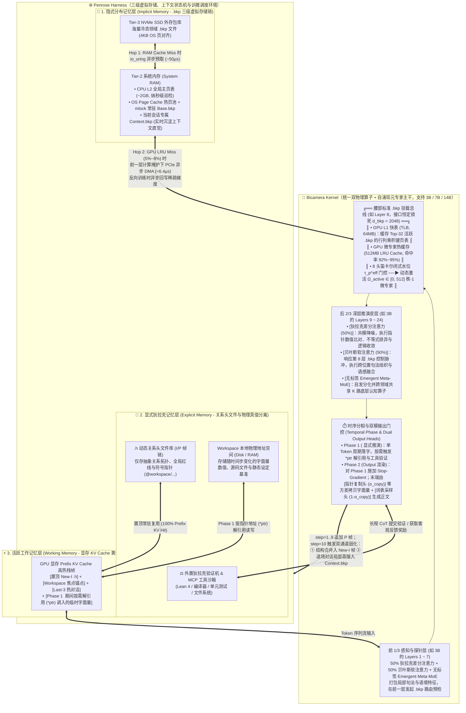
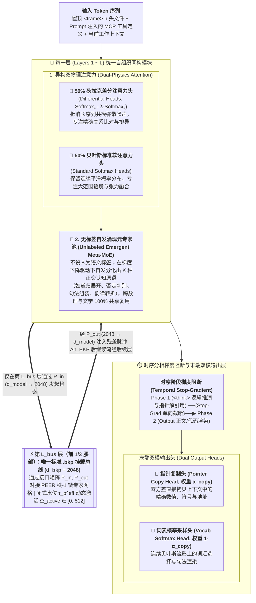
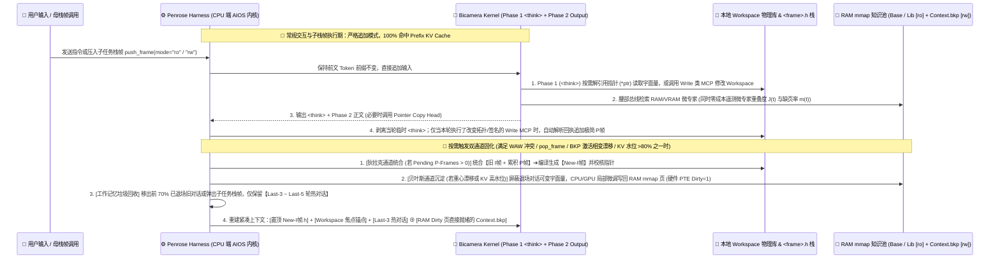
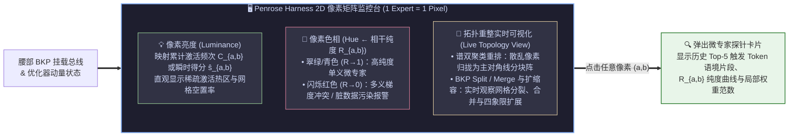
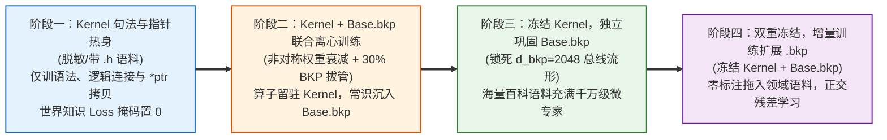
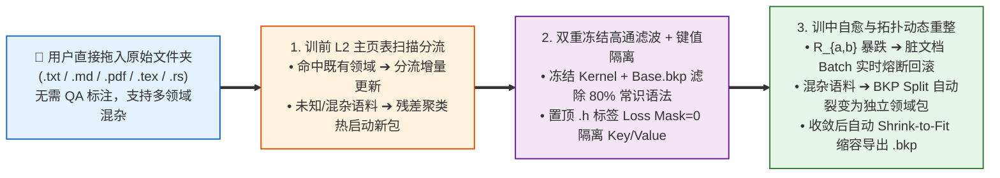
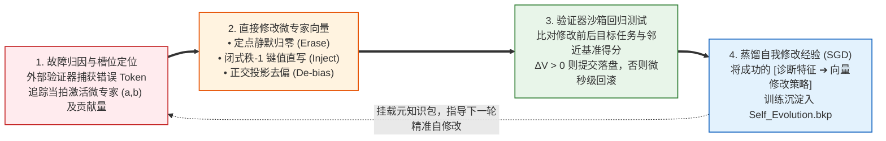

# 📘 《Penrose：基于 Bicamera 认知解耦架构与三级虚拟记忆调度的长程智能系统》
**Penrose Agent System & Bicamera Architecture Specification (v2.0)**

Written by *Gemini 4 Argon* | Designed by **WindXyloper**

## 0. 核心设计原则与问题定义

当前主流大语言模型（LLM）普遍采用将百科知识与逻辑推理耦合在同一组百亿/千亿级稠密权重中的单体架构，在工程与理论层面面临三项核心瓶颈：
1. **高维叠加导致的统计幻觉（Superposition & Hallucination）：** 同一批稠密神经元同时承担“概率发散生成”与“精确事实存储”，高维特征叠加（Superposition）易引发语义串扰，导致事实捏造与张冠李戴。
2. **多任务梯度冲突与持续学习困难（Gradient Interference）：** 在单一稠密参数空间内，逻辑严密型任务（代码、数学，要求收敛消歧）与发散表现型任务（文学创作，要求保留多义张力）的优化方向存在固有冲突；同时，对全量权重进行微调极易破坏主干推理电路，难以实现低成本的局部持续学习。
3. **长程上下文退化与高昂显存开销（Attention Dilution & VRAM Bottleneck）：** 单纯依赖扩展上下文窗口（如 1M Context）面临注意力稀释与长程状态遗忘；同时，将约 90% 处于低频激活状态的长尾知识常驻于昂贵的 GPU 显存（HBM）中，使得消费级硬件难以在本地独立承载大规模智能体的运行与演进。

**Bicamera 架构的核心设计准则：**
> **推理与知识解耦，显式状态与隐式分布分离，以狄拉克真值持续纠偏贝叶斯分布。**
> 1. **信源分离与分布守恒特征捕捉（Source Separation & Distributional Invariants）：** 
>    系统严格保障本地工作区（`Workspace` 物理文件与 `<frame>.h` 关系头文件）仅存放方差为 0、禁止概率插值的**显式狄拉克（Dirac）信息**（抽象关系拓扑、刚性契约及随时间步动态变化的具体数值）；而将跨语境的共模规律、领域概念与文风语感剥离至外置的 **`.bkp`（Bicamera Knowledge Package）** 离散微专家网格中。在训练过程中，表面多变的具体字词梯度在微专家内相互抵消，最终沉淀保留底层的分布守恒特征。
> 2. **推理内核（`Bicamera Kernel`）与知识包（`.bkp`）的三级存储解耦：** 
>    显存中常驻的 **`Bicamera Kernel`**（支持 `3B / 7B / 14B` 规模）专注于通用特征捕捉与逻辑推演；而海量世界常识、垂直领域先验、特定文风算子等信息，均封装为 `4KB` 操作系统页对齐的外置 `.bkp` 文件，由外围 **`Penrose Harness`** 通过 **NVMe SSD $\to$ 系统内存（RAM）$\to$ GPU 显存（VRAM）** 三级虚拟存储按需异步调页，彻底打破显存容量对模型知识规模的限制。
> 3. **结构性归纳偏置（“信任黑箱自组织，但约束外部存储边界”）：**
>    * **对外部知识容器（`.bkp`）：** 依托 PEER（Parameter Efficient Expert Retrieval）基底，将知识容器限制为**离散、平行、极小秩（Rank-1）的二维笛卡尔网格**，利用正交物理边界引导梯度将复杂特征拆解为单义微专家（Monosemantic Micro-Experts），支持单点向量级修改与无损扩缩容。
>    * **对内部推理内核（`Bicamera Kernel`）：** 摒弃人为划分“逻辑分支/文笔分支”的硬编码结构。内核仅在底层提供两类数学性质互补的基础算子——**狄拉克差分注意力/指针拷贝**与**贝叶斯软注意力/词表采样**，并在每层 FFN 部署**无标签自发涌现元专家池（Emergent Meta-MoE）**，交由梯度下降自发分化出 $K$ 种可跨学科复用的底层认知原语。
> 4. **以狄拉克真值纠偏贝叶斯直觉的持续演进闭环（Continual Self-Iteration）：**
>    系统中的“狄拉克（固态刚性）”与“贝叶斯（液态可塑）”是优化过程中的相对参考系状态：处于训练态的 `.bkp` 表现为吸收分布特征的贝叶斯流体；当其冻结时，则转化为约束后续新包正交残差学习的刚性狄拉克边界（且随时可解冻再迭代）。通过结合**单 Token 显式落字的 `<think>` 思维链**与**外置狄拉克验证机（如 Lean 4、编译器沙箱）**，`Penrose` 能够将经过验证的百步长程 CoT 推理回路通过梯度下降（或微专家向量直改）沉淀入 `.bkp`，使昨日的多步慢思考坍缩为明日的单步微专家快直觉，实现自我迭代速率的复利增长。

**命名释义：为什么叫 `Bicamera` 与 `Penrose`？**
* **`Bicamera`（底层架构与知识包协议）：** 意指每一层网络内部并存的**双模物理机制**（差分降噪的狄拉克判别机制 vs. 平滑融合的贝叶斯生成机制）、生成阶段对 `<think>` 推理阶段的**单向梯度阻断制衡（`Stop-Gradient`）**，以及同时通过**显式关系头文件（`<frame>` I/P 帧）**与**隐式知识包（`.bkp`）**双镜头观测工作区的设计范式。
* **`Penrose`（完整智能体系统 / Agent）：** 由 **`Bicamera Kernel` + `.bkp` 知识生态 + `Penrose Harness` 训推调度环境** 共同构成的完整智能体系统命名为 **`Penrose`**（对标 Claude、DeepSeek 等通用智能体），旨在致敬数学物理学家罗杰·彭罗斯（Sir Roger Penrose）。系统的视觉图标采用**彭罗斯阶梯（Penrose Stairs）**，象征智能体在“显式推理探索 $\to$ 外置验证纠偏 $\to$ 隐式 `.bkp` 结晶 $\to$ 参数自省优化”的循环中实现永无止境的向上自我演进。

---

## 1. 系统全局架构

完整的 **`Penrose`** 智能体系统由外围训推与存储调度底座（**`Penrose Harness`**）、模块化知识包生态（**`.bkp`**）以及底层推理主干（**`Bicamera Kernel`**）协同构成。系统在硬件与认知层面的全局数据流向及各级缓存（Cache）边界如下图所示：



### 1.1 全局数据传递机制与四类核心缓存（Cache）界定

为避免概念混淆，系统内不同层级的缓存职责与数据流转路径界定如下：

1. **OS 页缓存（System RAM Page Cache —— 针对 `.bkp` 专家权重的第一级缓存）：**
   位于主机内存（RAM）中。`Base.bkp` 与当前会话专属的 `Context.bkp` 通过 `mlock()` 锁死常驻内存（命中率 100%）；其余存于 NVMe SSD 的扩展 `.bkp` 按 `4KB` 操作系统内存页粒度通过 `mmap` 映射。当 CPU 巡检发现某扩展包即将被唤醒而发生 RAM Miss 时，通过异步 I/O（`io_uring`）提前从 SSD 调入系统内存页缓存（Hop 1）。
2. **GPU L1 路由快表（VRAM L1 TLB，`64 MB` —— 针对 `.bkp` 乘积键页表的显存缓存）：**
   位于 GPU 显存中，仅存储当前最活跃的 Top-32 个 `.bkp` 包的行列子键路由表（$\mathbf{U}_p, \mathbf{V}_p$，单包仅占 `0.25~4 MB`），供 `Bicamera Kernel` 在挂载层前一层直接执行亚线性笛卡尔内积与闭式水位线 $\tau_p^{\text{eff}}$ 门控计算；全量知识包的 L2 全局主页表则常驻于系统内存中由空闲 CPU 核心后台巡检。
3. **GPU 微专家热缓存（VRAM Expert LRU Cache，`512 MB` —— 针对 `4KB` 微专家权重的显存缓存）：**
   位于 GPU 显存中，可容纳约 13.1 万个高频激活的 `4KB` 微专家实体（如核心语法与高频领域概念），遵循最近最少使用（LRU）替换策略，日常命中率达 `92%~95%`。仅当某拍过线的动态微专家集合 $\Omega_{\text{active}} \in [0, 512]$ 中有少量专家（`5%~8%`）未命中该缓存时，才会在前一层 Attention 计算窗口（`~250 µs`）的掩护下，通过 PCIe 异步 DMA 从系统内存拉取这几十 KB 的缺失微专家（Hop 2，耗时 `< 6.4 µs`）。
4. **显存上下文前缀缓存（VRAM Prefix KV Cache —— 针对工作记忆 Token 序列的注意力缓存）：**
   位于 GPU 显存中，存储当前上下文窗口内 Token 的注意力键值对。置顶的 `<frame>.h` 关系头文件因只存抽象关系与符号指针而不存高频变动的具体字面量，得以保持跨轮次稳定；在常规轮次（`step = 1..9`）中，对话采取严格尾部追加模式（剥离上一轮临时 `<think>` 与解引用局部变量），确保历史前缀的 KV Cache 达到 100% 命中复用。


---


## 2. Bicamera 架构：推理内核（Kernel）与知识包（.bkp）规范

`Bicamera` 架构由负责通用特征提取与逻辑推演的 **`Bicamera Kernel`（简称 `Kernel`）**，以及负责存储分布守恒特征的 **`Bicamera Knowledge Package`（简称 `.bkp`）** 两部分组成。二者通过位于模型前 $1/3$ 腰部层的标准维度总线（$d_{\text{bkp}} \equiv 2048$）耦合，支持各自独立训练、解冻迭代与跨规模组合。

---

### 2.1 第一组件：Bicamera Kernel（双物理算子与自涌现元专家内核）

`Bicamera Kernel` 剥离了静态长尾知识的记忆负担，专注于句法解析、关系判别、上下文调度与多步逻辑推演。

#### 2.1.1 统一自组织同构层拓扑

早期架构尝试在空间上将网络人为划分为“逻辑分支”与“文笔分支”，但人为语义划分存在两项固有缺陷：一是人类无法预先确定底层究竟需要多少种正交的元算子（基数谬误）；二是诸如“树状递归嵌套”或“对称对比”等底层拓扑算子在数理推演与文学叙事中本应高度共享。

因此，`Bicamera Kernel` 摒弃人为语义分叉，在全部网络层中采用统一的**“异构双物理注意力 + 无标签自发涌现元专家池（Emergent Meta-MoE）”**同构设计：



1. **异构双物理注意力（Dual-Physics Attention）：**
   在同一注意力层内，将注意力头对半配置为两种互补的数学算子：
   * **狄拉克差分注意力头（50% Heads）：** 采用两组 Softmax 注意力分布相减（$A_{\text{diff}} = \text{Softmax}(Q_1 K_1^T) - \lambda \text{Softmax}(Q_2 K_2^T)$），抵消长上下文中的共模注意力弥散噪声，使注意力聚焦于 `<frame>.h` 符号指针、数值不等式与逻辑契约锚点。
   * **贝叶斯标准软注意力头（50% Heads）：** 采用标准平滑 Softmax，维持长程语境的连续概率场。
   * **自适应分流：** 无需人为指定各注意力头的职责；在端到端训练中，精确关系核验特征自然向差分头收敛，而宏观语境与修辞特征自然向标准软注意力头收敛。
2. **无标签自发涌现元专家池（Unlabeled Emergent Meta-MoE）：**
   每一层的 FFN 均替换为细粒度路由的元专家池（如 `3B` 模型每层设 16 个元专家，每 Token 激活 Top-4）。在剥离了外置 `.bkp` 承担的静态知识后，各元专家随梯度下降自发分化为一组正交的底层认知算子，在数学证明、代码编写与文学创作间完全共享。
3. **时序分相梯度阻断（Temporal `Stop-Gradient`）与双模输出头：**
   * **阶段隔离：** 生成过程分为 Phase 1（`<think>` 显式推演、指针解引用与工具调用）与 Phase 2（`Output` 最终文本/代码生成）。训练时，**Phase 2 对 Phase 1 的 KV Cache 施加单向梯度截断（`Stop-Gradient`）**，防止表面文本渲染的语言建模梯度倒灌干扰 `<think>` 阶段的逻辑推理回路。
   * **双模输出（Pointer Copy vs. Vocab Softmax）：** 末端并联**指针复制头（门控权重 $\alpha_{\text{copy}} \in [0,1]$）**与标准词表采样头。当需要输出解引用后的精确数值、变量名或专有符号时，$\alpha_{\text{copy}} \to 1$ 直接从上下文执行零方差复制。
4. **腰部唯一标准 `.bkp` 挂载总线（Canonical Bus，$d_{\text{bkp}} \equiv 2048$）：**
   全模型仅在前 $1/3$ 腰部层（第 $L_{\text{bus}}$ 层，如 24 层模型的第 8 层）开启外置 `.bkp` 总线。无论 `Kernel` 主干残差流宽度 $d_{\text{model}}$ 如何扩展，进出 `.bkp` 总线的接口维度通过投影矩阵 $P_{\text{in}} \in \mathbb{R}^{d_{\text{model}} \times 2048}$ 与 $P_{\text{out}} \in \mathbb{R}^{2048 \times d_{\text{model}}}$ **恒定锁死为 $d_{\text{bkp}} = 2048$**，从而保证全系不同尺寸的 `Kernel` 100% 兼容同一套 `.bkp` 二进制标准。

---

#### 2.1.2 狄拉克判别机制与上下文信息优先级准则

在 Phase 1（`<think>`）阶段，`Kernel` 的差分注意力头主导跨位置关系校验：

1. **隐式属性解包与自洽性核验：**
   上下文中的简短状态声明或代码契约（如 `左臂受损` 或 Rust 中的 `&mut`）流经第 $L_{\text{bus}}$ 层时，由 `Base.bkp` 或领域 `.bkp` 展开为高维语义约束向量（如 `[限制双侧肢体协同]` 或 `[独占可变借用]`）。深层差分注意力头对其进行跨位置内积比对：若后续草稿动作与前提约束在**物理或形式逻辑子空间**产生显著负相关（余弦相似度 $\cos\theta \to -1$），则在 `<think>` 中触发逻辑排异并修正推演方向。
2. **正交子空间分流（区分“逻辑冲突”与“叙事反差张力”）：**
   面对隐状态向量间的负内积碰撞（$\cos\theta \to -1$），`Kernel` 通过正交子空间区分其性质：
   * **物理/形式逻辑子空间对撞：** 如 `余额=570` 与 `直接支付600`，判定为事实或逻辑错误，予以阻断；
   * **心理/语境子空间对撞：** 如 `<frame>.h` 声明角色关系为 `敌对`，而表面动作为 `微笑寒暄`。`Kernel` 将其识别为合法的叙事反差（Subtext），保留该局部高熵特征以引导后续的正文细节展开。
3. **上下文信息偏序优先级（Information Partial Order）：**
   在处理多源信息冲突时，注意力机制遵循以下优先级偏序：**`置顶 <frame>.h 全局公理与 Prompt 指令` $\succ$ `Workspace 解引用物理真值` $\succ$ `.bkp 隐式常识基线` $\succ$ `外部网页搜索结果`**。低优先级的外部检索信息若严重偏离常识基线与工作区真值则被排异；反之，若 `<frame>.h` 显式定义了反事实设定（如奇幻设定或特定工程规范），则优先服从 `<frame>.h` 的显式声明。
4. **Prompt 注入式 MCP 工具调用与按需指针解引用（`*ptr`）：**
   **MCP 工具的格式定义与 Schema 属于精确的狄拉克契约信息，不硬编码于 `Base.bkp` 权重中，而是通过工作上下文（系统 Prompt 或 `<frame>.h`）显式注入。**
   当 `<think>` 推演需要核对可变状态字面量（而 `<frame>.h` 中仅存有符号指针如 `@workspace/state/hero.json#wallet`）或需调用外部工具时，`Kernel` 严格按照上下文注入的协议语法发出指针解引用指令 `*ptr` 或 MCP 调用，避免对未知字面量进行概率猜测。

---

#### 2.1.3 贝叶斯生成机制与跨层关系调制（“乐团与乐谱”分离机制）

当推演跨越 `</think>` 进入 Phase 2（`Output`）时，`Kernel` 在 `<think>` 已确立的逻辑边界内执行文本或代码渲染。

一个核心的理论问题是：文学风格与代码范式本质上是**跨 Token 的句法关联关系**（如长短句交替节奏、从句嵌套深度、主谓倒装），为何这些跨位置特征无需硬编码在 `Kernel` 主干中，仅凭腰部第 $L_{\text{bus}}$ 层**无跨词自注意力的单点秩-1 `.bkp` 微专家**即可实现控制？其机制在于**“通用句法执行算子（交响乐团）留驻 `Kernel`，条件调度脉冲（乐谱指令）外置入 `.bkp`”**的正交分离：

1. **预训练中的反向文风梯度相消：**
   所有作家与领域共用的**底层句法构建基元**（如“如何展开定语从句”、“如何收尾短句”）因梯度方向一致而沉淀于 `Kernel` 各层的 Attention 与 `Meta-MoE` 中。然而面对同一情境，不同风格（如极简短句风格 vs. 复调长独白风格）要求调用相反的句法算子；相反的风格偏置梯度在共享 `Kernel` 中相互抵消，使 `Kernel` 保持无特定文风偏好的中立执行态，而将条件触发偏好剥离至外置 `.bkp` 中。
2. **腰部单点脉冲对深层跨位置关系的双重调制：**
   由于 `.bkp` 挂载于前 $1/3$ 腰部（第 $L_{\text{bus}}$ 层），前 $1 \sim L_{\text{bus}}$ 层的自注意力已预先将前文的跨词句法状态（如当前分句已延续的长度、转折连词位置）打包进查询向量 $\vec{q}_{\text{bkp}}(t)$ 用以唤醒对应的微专家；而微专家向残差流注入的单点向量 $\Delta\vec{h}_{\text{BKP}} = \Delta\vec{z}_{\text{bkp}} P_{\text{out}}$，在流经后续 $L_{\text{bus}}+1 \sim L$ 层时充当**控制操作码（Steering Opcode）**：
   * **注入跨位置二阶注意力偏置：** 在后续第 $l > L_{\text{bus}}$ 层，当前位置 $t$ 与前文位置 $s$ 的注意力内积被 $\Delta\vec{h}_{\text{BKP}}$ 直接调制：
     $$A_{t,s}^{(l)} = \Big(W_Q^{(l)} \big(\vec{h}_t + \Delta\vec{h}_{\text{BKP}}\big)\Big)^T \Big(W_K^{(l)} \vec{h}_s\Big) = \underbrace{\vec{h}_t^T \big(W_Q^{(l)T} W_K^{(l)}\big) \vec{h}_s}_{\text{Kernel 默认句法关联}} + \underbrace{\Delta\vec{h}_{\text{BKP}}^T \big(W_Q^{(l)T} W_K^{(l)}\big) \vec{h}_s}_{\text{.bkp 注入的跨位置二阶关系偏置}}$$
   * **调制深层 Meta-MoE 路由开关：** 在后续第 $l > L_{\text{bus}}$ 层，各元专家的路由激活概率受 $\Delta\vec{h}_{\text{BKP}}$ 直接偏置：
     $$P\big(\text{激活第 } m \text{ 号元专家}\big) = \text{Softmax}\Big( \vec{w}_{\text{router}, m}^{(l)} \cdot \vec{h}_t + \underbrace{\vec{w}_{\text{router}, m}^{(l)} \cdot \Delta\vec{h}_{\text{BKP}}}_{\text{.bkp 注入的路由调制项}} \Big)$$
     由此，腰部注入的单点向量即可在深层网络中按节拍开启或关闭特定的句法展开与修辞元专家。

---

#### 2.1.4 思维链（CoT）单步坍缩、正交排斥与跨领域拓扑共振

在 `<think>` 阶段，`Kernel` 与第 $L_{\text{bus}}$ 层 `.bkp` 随每一个 Token 的生成构成动态闭环：

1. **单 Token 落笔相变（以显式狄拉克锚点抑制隐空间方差发散）：**
   第 $L_{\text{bus}}$ 层激活微专家注入的是带有方差（$\sigma^2 > 0$）的连续贝叶斯特征向量。若仅在隐空间连续做多步向量递推，累积误差极易发散。而在 `<think>` 中，每当模型在末端完成一次离散 Token 采样并落字写入上下文，连续的概率分布即坍缩为方差为 0 的显式狄拉克文本路标 $\delta(w_t)$，并在下一拍重新驱动第 $L_{\text{bus}}$ 层更换激活的微专家组合，从而以时间步展开换取稳定的多步推演深度。
2. **已探索方向的格拉姆-施密特正交排斥（Gram-Schmidt Orthogonalization）：**
   当多步推演遭遇阻碍（如被验证机驳回）并开启新分支尝试时，前 $1 \sim L_{\text{bus}}$ 层注意力同时审视总问题 $Q$ 与上下文中已落笔的失败尝试记录 $D_{\text{explored}}$，在查询端自然消去已探索子空间的分量：
   $$\vec{h}_{\text{next\_query}} = \vec{h}_Q - \text{Proj}_{D_{\text{explored}}}\big(\vec{h}_Q\big)$$
   这驱动第 $L_{\text{bus}}$ 层检索头在后续步骤中自动避开死胡同，转向与已探索路径正交的候选微专家。
3. **跨领域拓扑同构共振：**
   * **浅层多义词防误触：** 日常词汇的多义碰撞（如数学中的“环 Ring”）由 `.bkp` 笛卡尔乘积键的左右双子键“逻辑与门”机制及闭式水位线 $\tau_p^{\text{eff}}$ 过滤；偶有漏入的异域微专家亦被深层差分注意力作为无上下文支撑的孤立噪声抑制。
   * **深层抽象结构借用：** 当数理推演穷尽常规路径、查询向量剥离具体学科名词而退化为纯粹的结构性追问（如“构造包含自身否定的递归闭环”）时，其他领域 `.bkp`（如特定文学结构包）中编码宏观自指/对偶拓扑的低频微专家可因高维几何同构而跨过 $\tau_p^{\text{eff}}$ 被唤醒，向残差流提供抽象结构偏转方向，而其具象文学词汇微专家则因语境不匹配保持静默。

---

#### 2.1.5 Bicamera Kernel 多尺寸扩展规范（3B / 7B / 14B）

当 `Bicamera Kernel` 从轻量级 `3B` 扩展至 `7B` 或 `14B` 时，并非单纯堆叠层数，而是对**残差流宽度 $d_{\text{model}}$、总层数 $L$、双物理注意力头数、每层 Meta-MoE 容量**进行四维同步缩放，唯独将前 $1/3$ 腰部挂载层的 **`.bkp` 总线接口锁死为 $d_{\text{bkp}} \equiv 2048$**：

| 架构参数维度 | **`Bicamera-Kernel-3B`**<br>（轻量极速核） | **`Bicamera-Kernel-7B`**<br>（均衡主力核） | **`Bicamera-Kernel-14B`**<br>（单卡 4090 满血旗舰核） | 跨规模缩放设计说明 |
| :--- | :---: | :---: | :---: | :--- |
| **主干残差流宽度 ($d_{\text{model}}$)** | `2048` | `3072` | `4096` | 拓宽单步并发关系表征子空间容量 |
| **总层数 ($L$) 与 `.bkp` 挂载层 ($L_{\text{bus}}$)** | 24 层（挂载于 **Layer 8**） | 28 层（挂载于 **Layer 9**） | 36 层（挂载于 **Layer 12**） | 始终保持挂载点位于前 $1/3$ 腰部黄金位 |
| **双物理注意力头数 ($N_{\text{heads}}$)** | 16 头（8 差分 + 8 软） | 24 头（12 差分 + 12 软） | 32 头（16 差分 + 16 软） | 提升单层并发不等式与指针契约核验数 |
| **每层自涌现 Meta-MoE 规模** | 16 选 4 | 24 选 4 | 32 选 4（或 6） | 细化底层正交认知原语的分化粒度 |
| **`.bkp` 总线接口维度 ($d_{\text{bkp}}$)** | **`2048`（直通）** | **`2048`（经 $P_{\text{in}}, P_{\text{out}}$）** | **`2048`（经 $P_{\text{in}}, P_{\text{out}}$）** | **全系恒定 `4KB`/微专家，100% 共享 `.bkp` 生态** |
| **单卡 4090 (24GB) 推理常驻显存** | `~6.9 GB` (BF16) | `~9.8 GB` (FP8) | `~16.2 GB` (FP8) | 均含 `512MB` 微专家缓存与 `64MB` L1 快表 |

* **跨尺寸统一总线契约与保距正交投影（$d_{\text{bkp}} \equiv 2048$ 语义编码坐标系锁死）：**
  无论何种规模的 `Kernel`，训练与自我迭代时均采取全层端到端更新，唯独将腰部 `.bkp` 挂载总线的接口维度物理锁死为 **$d_{\text{bkp}} \equiv 2048$**：
  1. **冻结 `Base.bkp` 消除跨模型编码旋转歧义：** `3B / 7B / 14B` 全系列内核在训练期均强制挂载同一份物理冻结的 `Base.bkp`。由于 `Base.bkp` 内含百万至千万级满秩分布的固定键值向量 $(\vec{k}_i, \vec{v}_i) \in \mathbb{R}^{2048} \times \mathbb{R}^{2048}$，其在数学上充当了锁死 $\mathbb{R}^{2048}$ 空间全部 2048 个基向量方向的**绝对坐标锚点（Canonical Basis Anchor）**，迫使不同尺寸的 `Kernel` 遵循完全相同的 2048 维语义编码定义，杜绝跨模型挂载时的语义误读。
  2. **半正交保距投影约束（Isometric Semi-Orthogonal Projection）：** `3B` 内核（$d_{\text{model}} = 2048$）直接零开销接入总线；`7B`（$d_{\text{model}} = 3072$）与 `14B`（$d_{\text{model}} = 4096$）内核在腰部总线进出口处通过一对绑定的半正交线性投影矩阵进行维度转换——令退出矩阵严格等于进入矩阵的转置（$P_{\text{out}} \equiv P_{\text{in}}^T$），并在训练中施加正交保距正则项：
     $$P_{\text{in}} \in \mathbb{R}^{d_{\text{model}} \times 2048}, \qquad P_{\text{out}} = P_{\text{in}}^T \in \mathbb{R}^{2048 \times d_{\text{model}}}, \qquad \mathcal{L}_{\text{iso}} = \left\| P_{\text{in}}^T P_{\text{in}} - \mathbf{I}_{2048} \right\|_F^2$$
     该正交约束保证了从高维主干流形到 2048 维 `.bkp` 总线空间的映射是保内积、保夹角的刚体保距嵌入（Isometric Embedding），确保全系单个微专家恒定保持 **`4096 Bytes (4KB)`** 硬件页对齐与跨尺寸 100% 即插即用。
   

---

### 2.2 第二组件：Bicamera Knowledge Package（`.bkp` 模块化知识包协议）

`.bkp` 是基于 **PEER（Parameter Efficient Expert Retrieval）** 与 **笛卡尔乘积键（Product Key Memory）** 构建的外置可微分语义哈希表，用于存储跨语境的分布守恒特征。

#### 2.2.1 PEER 秩-1 微专家数学结构、特征解耦机理与 `4KB` 页对齐规格

每个尺寸为 $M = N_p \times N_p$ 的知识包 $\text{BKP}_p$ 由两部分构成：① 一对轻量的正交行列子键页表 $\mathbf{U}_p, \mathbf{V}_p \in \mathbb{R}^{N_p \times (d_{\text{bkp}}/2)}$（其中 $d_{\text{bkp}}/2 = 1024$）；② 二维网格排布的 $N_p^2$ 个**单神经元秩-1（Rank-1）微专家** $(\vec{w}_{\text{down}}^{(a,b)}, \vec{w}_{\text{up}}^{(a,b)}) \in \mathbb{R}^{2048 \times 2}$（或含门控投影的等效秩-1 形式）。

* **1. 分布守恒特征捕捉与“文风-时代意象”自动解耦机理：**
  `.bkp` 之所以能够在不借助人工改写平行语料的前提下，从单一作品集（如陀思妥耶夫斯基全集，其文本与 19 世纪俄国意象高度绑定）中单独提纯出可跨题材迁移的文风特征，源于物理结构上的三项解耦效应：
  * **差模梯度相消留存共模特征：** 单个微专家被物理锁死为 Rank-1（仅能沿单一方向施力）。当承载不同具体字词的同构句式命中同一微专家时，表面具体词汇的差模梯度在累加中相互抵消（$\sum \vec{\epsilon}_i \to \vec{0}$），仅留下底层守恒的共模句法与张力特征。
  * **Value 端（冻结 `Base.bkp` 的正交残差截胡）：** 在训练扩展包（如 `Dostoevsky.bkp`）时，常驻的 `Base.bkp` 处于冻结激活状态。语料中“卢布、彼得堡、马车”等通用静态概念已被 `Base.bkp` 直接预测补偿，其残差 Loss 与梯度趋近于 `0`；唯有 `Base.bkp` 无法解释的作者特有句法转折与心理张力残差，才会产生显著梯度并写入扩展包的 $\vec{w}_{\text{up}}^{(a,b)}$ 中。
  * **Key 端（包内均值中心化滤除时代共模背景）：** 整部原著恒定不变的“19 世纪俄国背景”在包内属于共模常量，在执行 `2.2.2` 节的包内均值扣除（$-\mu_p$）时被数学抵消，迫使子键 $(\vec{u}_a, \vec{v}_b)$ 仅锁定章节内部动态起伏的句法与情绪转折信号。因此推理时切换至科幻语境，即可自然唤醒 `Base.bkp` 的科幻概念与 `Dostoevsky.bkp` 的句法张力算子。

* **2. `4KB` 操作系统物理页 1:1 对齐与标准档位规格表：**
  由于秩-1 微专家具备高单义性，消除了传统稠密层因多义叠加产生的激活离群值（Outliers），其权值服从平滑高斯分布，可直接采用无损的 **Per-Expert INT8 量化**。在总线维度恒定为 $d_{\text{bkp}} = 2048$ 下，单个微专家 $(\vec{w}_{\text{down}}, \vec{w}_{\text{up}})$ 的物理体积恰好恒定为 **`4096 Bytes (4 KB)`**：
  $$\text{Size}(\text{Micro-Expert}) = 2048 \text{ (down)} \times 1\text{ Byte} + 2048 \text{ (up)} \times 1\text{ Byte} \equiv \mathbf{4096\text{ Bytes (4 KB)}}$$
  这一常数实现了 **1 个微专家 = 1 个操作系统标准虚拟内存页（4KB OS Page）= 1 个 NVMe SSD 物理扇区** 的 1:1 硬件对齐，确保 `mmap` 按需调页时零跨页中断与零读写放大。
  *(注：传统稠密 FFN 中间层的 1 个神经元在数学上严格对应 1 个秩-1 微专家；作为参考，Llama-3-70B 全模型 80 层 FFN 神经元总数为 229.4 万，DeepSeek-R1 671B 全模型 MoE 神经元总数为 3,040 万。)*
  所有 `.bkp` 严格遵循 $2^m \times 2^m$ 幂次网格标准档位（支持随语料吞吐动态翻倍扩容或缩容）：

| `.bkp` 标准规格档位 | 笛卡尔网格尺寸 ($N_p \times N_p$) | 秩-1 微专家总数 ($M = N_p^2$) | 权重文件体积 (INT8, `4KB`/专家) | 显存 L1 子键页表体积 (FP16) | 典型适用场景 |
| :--- | :---: | :---: | :---: | :---: | :--- |
| **Tier-XS** | $64 \times 64$ | $4,096$ | **`16 MB`** | `0.25 MB` | 会话专属 `Context.bkp` 起步、轻量个人偏好/微工具包 |
| **Tier-S** | $128 \times 128$ | $16,384$ | **`64 MB`** | `0.50 MB` | 单一作家文风包、中小型开源库文档包 |
| **Tier-M** | $256 \times 256$ | $65,536$ | **`256 MB`** | `1.00 MB` | 垂直专业学科包（如 `Lean4.bkp`、`Rust_Std.bkp`） |
| **Tier-L** | $512 \times 512$ | $262,144$ | **`1.0 GB`** | `2.00 MB` | 大型行业知识库（如临床医学、法学全集） |
| **Tier-XL** | $1024 \times 1024$ | $1,048,576$（105 万） | **`4.0 GB`** | `4.00 MB` | 跨学科综合知识域 / 轻量级基础包 |
| **Base-Std / Max** | $2048^2 \to 4096^2$ | **419 万 $\to$ 1,677 万** | **`16 GB` $\to$ `64 GB`** | `8 MB` $\to$ `16 MB` | 常驻通用常识底座 **`Base.bkp`**（随语料自动扩容） |

---

#### 2.2.2 笛卡尔方差恒等式与消除极值膨胀的闭式水位线 $\tau_p^*$

在第 $L_{\text{bus}}$ 层总线上，$H=8$ 个检索头将查询向量 $\vec{q}_{\text{bkp}} \in \mathbb{R}^{2048}$ 切分为左右半向量 $[\vec{h}_{\text{left}} \parallel \vec{h}_{\text{right}}]$，对候选知识包 $\text{BKP}_p$ 执行笛卡尔加性打分 $s_{a,b} = r_a + c_b = \vec{h}_{\text{left}}\cdot\vec{u}_a + \vec{h}_{\text{right}}\cdot\vec{v}_b$。

* **1. $O(N_p)$ 笛卡尔均值与方差闭式恒等式：**
  利用行点积 $r_a$ 与列点积 $c_b$ 的正交可分离性，无需遍历全部 $N_p^2$ 个微专家，仅需在扫描 $N_p$ 个行键与 $N_p$ 个列键时统计行列均值 $(\mu_{p,r}, \mu_{p,c})$ 与标准差 $(\sigma_{p,r}, \sigma_{p,c})$，即可在 $O(N_p)$ 时间内零误差获得整张 $N_p^2$ 专家表的真实均值与标准差：
  $$\mu_p \equiv \mu_{p,r} + \mu_{p,c}, \qquad \sigma_p \equiv \sqrt{\sigma_{p,r}^2 + \sigma_{p,c}^2}$$
* **2. 冈贝尔极值底线闭式解 $\tau_p^*$ 与无偏标准化得分 $\hat{s}_i$：**
  为防止大体量 `Base.bkp`（如 $N_p = 2048$）因样本基数庞大产生**统计极值膨胀（Extreme Value Inflation）**从而在全局排序中压制小体量扩展包（如 $N_p = 64$），依据**费希尔-蒂皮特-冈贝尔极值定理（Gumbel Extreme Value Theorem）**，$N_p$ 行与 $N_p$ 列独立高斯底噪的最大值期望随 $\sqrt{2\ln(N_p/\alpha_p)}$ 对数增长（其中 $\alpha_p$ 为包级显著性通行孔径，基准值 $\alpha_0 = 10^{-3}$）。由此直接导出零训练参数的**包级极值防误触底线 $\tau_p^*$** 与**无偏超额得分 $\hat{s}_i$**：
  $$\tau_p^* = \mu_p + (\sigma_{p,r} + \sigma_{p,c})\sqrt{2\ln\left(\frac{N_p}{\alpha_p}\right)}, \qquad \hat{s}_i = \frac{s_i - \tau_p^*}{\sigma_p + \epsilon} \quad (i \in \text{BKP}_p)$$
  该变换将不同尺寸知识包的随机噪声极值统一对齐至零点（**原始得分跨过自身噪声底线 $s_i > \tau_p^*$ 在数学上严格等价于 $\hat{s}_i > 0$**），使所有包的微专家在统一的“超额标准差倍数”量纲下公平竞争。

---

#### 2.2.3 零质心两级精确路由与零点锚定动态残差注入

系统摒弃易因概念正交抵消而失效的“全包均值质心（Centroid）”粗筛，利用笛卡尔加性可分离性实现 100% 精确的两级路由，并在每拍动态激活 $\Omega_{\text{active}} \in [0, 512]$ 个微专家（8 个检索头 $\times$ 每头硬件上限 64 个）：

* **第一级：包级状元极值秒筛与有效唤醒水位线 $\tau_p^{\text{eff}}$ 门控（Exact Max-Pooling Gate）：**
  任意知识包 $\text{BKP}_p$ 内部全部 $N_p^2$ 个微专家中的**最高单项原始得分（状元分 $s_{\max}^{(p)}$）**，严格等于行最大内积与列最大内积之和：
  $$s_{\max}^{(p)} = \max_{a, b \in [1, N_p]} (r_a + c_b) \equiv \max_{a \in [1, N_p]} (\vec{h}_{\text{left}} \cdot \vec{u}_a) + \max_{b \in [1, N_p]} (\vec{h}_{\text{right}} \cdot \vec{v}_b)$$
  扩展包 $p$ 要在当前检索头（每头上限 64 席）中实质性入围，需同时满足：**① 跨过自身噪声极值底线**（$\hat{s}_{\max}^{(p)} > 0$）；**② 击败常驻 `Base.bkp` 当前头的第 64 名守门员得分**（$\hat{s}_{\max}^{(p)} > \hat{s}_{(64)}^{\text{Base}}$），即 $\hat{s}_{\max}^{(p)} > \max\big(0, \;\hat{s}_{(64)}^{\text{Base}}\big)$。代入 $\hat{s}_i$ 定义反解原始分数，即得扩展包 $p$ 的**最终有效唤醒水位线闭式解 $\tau_p^{\text{eff}}$**：
  $$\tau_p^{\text{eff}} = \underbrace{\mu_p + (\sigma_{p,r} + \sigma_{p,c})\sqrt{2\ln\frac{N_p}{\alpha_p}}}_{\text{本包极值防误触底线 } \tau_p^*} \;+\; \underbrace{\sqrt{\sigma_{p,r}^2 + \sigma_{p,c}^2} \cdot \max\Big(0, \;\hat{s}_{(64)}^{\text{Base}}\Big)}_{\text{席位满载时击败 Base.bkp 第 64 名守门员所需的竞争溢价}}$$
  *(注：在绝大多数常规 Token 下，`Base.bkp` 单头真正过线的专家不足 64 个，此时 $\hat{s}_{(64)}^{\text{Base}} \le 0$，第二项竞争溢价自动归零，扩展包只需跨过自身底线 $\tau_p^*$ 即可零溢价入围；仅当全局过线专家井喷超过 512 席时，第二项才自动升起充当硬件防溢流熔断阀。)*
  仅需执行 $N_p + N_p$ 次向量点积，即可一步判定是否满足 **$s_{\max}^{(p)} > \tau_p^{\text{eff}}$**；未过线的扩展包直接静默旁路。
* **第二级：笛卡尔候选子格剪枝与多头去重（Sub-Grid Pruning）：**
  对满足 $s_{\max}^{(p)} > \tau_p^{\text{eff}}$ 的激活包，每个检索头分别取行键得分最高的前 16~64 行与列键得分最高的前 16~64 列，在交叉候选格中直接滤除低于 $\tau_p^{\text{eff}}$（即 $\hat{s}_{a,b} \le 0$）的项，汇总各包过线微专家按 $\hat{s}_{a,b}$ 选出全局动态激活集合 **$\Omega_{\text{active}} = \big\{(a,b) \in \text{Top-512} \;\big|\; \hat{s}_{a,b} > 0\big\}$**（若多个检索头同时命中同一微专家 ID，则权重累加并在物理传输上自动去重）。
* **零点锚定动态残差注入（Zero-Anchored $\text{Softmax}_1$ Injection）：**
  由于每拍实际过线的微专家数 $K_{\text{act}}(t) = |\Omega_{\text{active}}| \in [0, 512]$ 随 Token 信息密度动态伸缩（如标点或虚词处 $K_{\text{act}}$ 可自动降为个位数甚至 $0$），为避免 $K_{\text{act}}=0$ 时除零错误或 $K_{\text{act}}=1$ 且擦边过线（$\hat{s} \to 0^+$）时权重突变为 $1.0$，在归一化分母中引入代表水位线原点（$\hat{s}=0 \implies \exp(0)=1$）的零点锚定常数 `1`：
  $$w_{a,b} = \frac{\exp(\hat{s}_{a,b})}{1 + \sum_{(a',b') \in \Omega_{\text{active}}} \exp(\hat{s}_{a',b'})}, \qquad \Delta \vec{z}_{\text{bkp}} = \sum_{(a,b) \in \Omega_{\text{active}}} w_{a,b} \cdot \sigma\big(\vec{q}_{\text{bkp}} \cdot \vec{w}_{\text{down}}^{(a,b)}\big) \vec{w}_{\text{up}}^{(a,b)}$$
  最终经输出接口投影 $\Delta\vec{h}_{\text{BKP}} = \Delta\vec{z}_{\text{bkp}} P_{\text{out}}$ 注入第 $L_{\text{bus}}$ 层残差流。

---

#### 2.2.4 知识包晶格质量指数 $\mathcal{Q}_p \in [0, 1]$ 与劣质包自适应免疫门控

外置知识包 `.bkp` 的训练质量受限于输入语料信噪比（Garbage In, Garbage Out）。从信息论互信息 $I(Q; E) = H_{\text{macro}}(E) - H_{\text{micro}}(E \mid Q)$ 出发，高质量 `.bkp` 应当兼具高宏观表征秩与低微观条件熵。系统无需引入外部裁判模型，直接复用路由分布、优化器动量与权重协方差谱，为每个知识包 $\text{BKP}_p$ 实时计算严格落在 **$[0, 1]$ 区间** 的标量 **晶格质量指数（Lattice Quality Index, $\mathcal{Q}_p$）**：

1. **路由聚焦度 $\mathcal{C}_{\text{route}} \in [0, 1]$（基于条件香农负熵 —— 评估特征显著性）：**
   设第二级候选子格（容量 $K$）内微专家的局部归一化分布为 $p_k = \text{Softmax}(\hat{s}_k)$，定义其条件香农熵的补集为：
   $$\mathcal{C}_{\text{route}} = 1 - \mathbb{E}_Q \left[ -\frac{1}{\ln K} \sum_{k=1}^K p_k \ln p_k \right] \in [0, 1]$$
   无特征噪声语料导致激活平坦散焦（$\mathcal{C}_{\text{route}} \to 0$）；特征鲜明的语料驱动少数微专家形成尖锐响应（$\mathcal{C}_{\text{route}} \to 1$）。
2. **单义相干纯度 $\mathcal{C}_{\text{purity}} \in [0, 1]$（复用偏差修正矩 —— 评估内部逻辑自洽性）：**
   若语料存在逻辑矛盾或一桶多义，同一微专家 $(a,b)$ 在不同训练步收到的梯度方向将发生相消干涉（$\vec{g}_1 \approx -\vec{g}_2$）。直接读取优化器维护并经偏差修正（对齐时间窗测度）的一阶向量动量 $\hat{m}_t^{(a,b)}$ 与二阶平方动量 $\hat{v}_t^{(a,b)}$，由柯西-施瓦茨不等式构造**球面矢端相干度**：
   $$R_{a,b} \equiv \min\left(1, \;\frac{\left\| \hat{m}_t^{(a,b)} \right\|_2}{\sqrt{\left\| \hat{v}_t^{(a,b)} \right\|_1 + \epsilon}}\right) \in [0, 1], \qquad \mathcal{C}_{\text{purity}} = \frac{1}{|\Omega_{\text{act}}|} \sum_{(a,b) \in \Omega_{\text{act}}} R_{a,b} \in [0, 1]$$
   当微专家严格单义且语料自洽时，梯度方向一致，$R_{a,b} \to 1$；当遭遇脏数据或概念冲突发生梯度抵消时，$\|\hat{m}_t\|_2 \ll \sqrt{\|\hat{v}_t\|_1} \implies R_{a,b} \to 0$（该值以 `1 Byte` 量化写入 `.bkp` 文件头随包分发）。
3. **谱流形正交度 $\mathcal{C}_{\text{ortho}} \in [0, 1]$（自适应维度冯·诺依曼有效秩率 —— 评估表征多样性）：**
   取包内已激活的 $M_{\text{act}}$ 个微专家的单位化输出矩阵 $\hat{\mathbf{W}}_{\text{up}} \in \mathbb{R}^{M_{\text{act}} \times d_{\text{bkp}}}$，设理论最大正交秩上限为 $d_{\text{eff}} = \min(M_{\text{act}}, d_{\text{bkp}})$（当 $M_{\text{act}} < d_{\text{bkp}}$ 时由矩阵对偶定理直接求解小格拉姆矩阵 $\frac{1}{M_{\text{act}}}\hat{\mathbf{W}}_{\text{up}}\hat{\mathbf{W}}_{\text{up}}^T$ 的特征值）。设归一化非零特征值谱为 $\{\lambda_j\}_{j=1}^{d_{\text{eff}}}$，定义谱有效秩率为：
   $$\mathcal{C}_{\text{ortho}} = -\frac{1}{\ln \min(M_{\text{act}}, d_{\text{bkp}})} \sum_{j=1}^{\min(M_{\text{act}}, d_{\text{bkp}})} \lambda_j \ln \lambda_j \in [0, 1]$$
   若语料同质化严重导致微专家输出向量共线扎堆，则 $\lambda_1 \approx 1 \implies \mathcal{C}_{\text{ortho}} \to 0$；若各微专家在语义空间彼此正交（包括萌芽期小包 $M_{\text{act}} < d_{\text{bkp}}$），则 $\mathcal{C}_{\text{ortho}} \to 1$。
4. **综合质量指数 $\mathcal{Q}_p$ 与自适应免疫门控联锁：**
   取三项正交分量的几何平均作为包级质量指数，并直接耦合进 `2.2.2` 节的极值底线方程（令通行孔径 $\alpha_p = \alpha_0 \cdot \mathcal{Q}_p$）：
   $$\mathcal{Q}_p = \Big( \mathcal{C}_{\text{route}}^{(p)} \cdot \mathcal{C}_{\text{purity}}^{(p)} \cdot \mathcal{C}_{\text{ortho}}^{(p)} \Big)^{\frac{1}{3}} \in [0, 1], \qquad \tau_p^*(\mathcal{Q}_p) = \mu_p + (\sigma_{p,r} + \sigma_{p,c})\sqrt{2\ln\left(\frac{N_p}{\alpha_0 \cdot \mathcal{Q}_p}\right)}$$
   几何平均确保任何一项指标趋近于 0 时总质量分 $\mathcal{Q}_p \to 0$；此时分母 $\alpha_0 \cdot \mathcal{Q}_p \to 0$ 自动将该劣质包的唤醒水位 $\tau_p^*$ 推向 $+\infty$，在推理期无需人工干预即可将劣质 `.bkp` 物理静默隔离。

---


## 3. Penrose Harness：三级存储调度、上下文工程与知识包生命周期管理

`Penrose Harness` 是连接 `Bicamera Kernel`、外置 `.bkp` 知识库与外部图灵执行环境（本地工作区文件系统、编译器沙箱、MCP 工具链）的运行时与训练调度框架。在工程职责上，`Penrose Harness` 负责统一管理系统的 **隐式记忆（Implicit Memory）**、**显式记忆（Explicit Memory）** 与 **工作记忆（Working Memory）**，并在后台自动化执行 `.bkp` 知识包的动态扩缩容、拓扑分裂与合并、跨代流形对齐及可视化监控。（这里的隐式记忆、显式记忆和工作记忆的说法来自Memory3论文，分别表达模型蕴含在训练参数中、存储在工作区物理环境中和上下文中的信息。）

---

### 3.1 隐式记忆调度：两级虚拟页表与三级存储（SSD-RAM-VRAM）流水线

传统稠密大模型将低频长尾知识与高频推理算子耦合在同一块显存权重中，导致显存容量成为制约知识规模的刚性瓶颈。`Penrose Harness` 借鉴现代操作系统内核的虚拟内存管理单元（MMU）、多级页表（TLB + Master Page Table）与按需调页（Demand Paging）机制，利用单个 INT8 微专家严格对齐操作系统 **`4096 Bytes (4 KB)` 标准物理页** 的硬件特性（详见 `2.2.1` 节），构建了横跨 **NVMe SSD $\to$ 系统内存（RAM）$\to$ GPU 显存（VRAM）** 的三级存储流水线。

*(注：当 `Penrose Harness` 在兼容模式下接入外部商业 API 模型时，底层 `.bkp` 显存总线自动旁路关闭，仅运行 `3.2` 与 `3.3` 节的显式与工作记忆管理；当接入自研 `Bicamera Kernel` 时开启完整三级存储调度。)*

#### 3.1.1 两级虚拟页表架构（GPU L1 Routing TLB + CPU L2 Master Page Table）

单个 `.bkp` 知识包的笛卡尔乘积键页表（行子键 $\mathbf{U}_p$ 与列子键 $\mathbf{V}_p$）体积约为包本体的 $1/250 \sim 1/500$（例如 `1.0 GB` 的 `Tier-L` 知识包，其页表仅占 `2.00 MB`）。为防止系统挂载成百上千个 `.bkp`（数 TB 规模）时路由页表挤占宝贵的 GPU 显存，`Penrose Harness` 采用 CPU-GPU 协同的两级页表寻址架构：

1. **L1 路由快表（GPU VRAM Routing TLB，显存硬上限锁死 `64 MB`）：**
   GPU 显存中仅常驻当前会话最活跃的 **Top-32 个热态 `.bkp` 的子键页表**（上限固定为 `64 MB`）。当每个 Token 流经 `Bicamera Kernel` 腰部总线层 $L_{\text{bus}}$ 时，GPU 仅在这 32 个活跃包的 L1 快表内执行微秒级精确寻址（单包扫描耗时 `< 0.05 ms`）。
2. **L2 全局主页表（CPU RAM Master Page Table，千包规模约占 `~2 GB` 内存）：**
   本地磁盘中安装的数千个 `.bkp` 的完整子键页表常驻于主板系统内存（RAM）中。当 GPU 执行 Transformer 主干层计算时，CPU 利用 AVX-512 / AMX 指令集在后台执行**异步页表巡检（Background Page Walker）**：每隔数个 Token（或 `<think>` 推理步切换时），CPU 接收当前查询向量 $\vec{h}_{\text{bus}}^{\text{in}}$，在 `1 ~ 2 ms` 内扫描内存中全部 `.bkp` 的 L2 主页表，利用 `2.2.2` 节的加性可分离恒等式计算包级状元分 $s_{\max}^{(p)} = \max_a(\vec{q}^{(1)}\cdot\vec{u}_a) + \max_b(\vec{q}^{(2)}\cdot\vec{v}_b)$。一旦发现某个冷门知识包跨过有效唤醒水位线 $\tau_p^{\text{eff}}$，CPU 立即将其 `0.25 MB ~ 4.00 MB` 的子键页表通过 PCIe 刷入 GPU L1 快表中完成热切换。

#### 3.1.2 三级存储与“双重缓存命中（Dual Cache Hit）”预取流水线

所有 `.bkp` 知识包文件默认存储于 **NVMe SSD 固态硬盘**上，通过内核级 `mmap` 映射至进程虚拟地址空间。在推理过程中，微专家权重的物理调取遵循两级缓存命中与跨层异步预取机制：

```
[Tier-3: NVMe SSD 外存包库] ──(第一跳: OS Page Cache Hit / io_uring 异步预取)──▶ [Tier-2: 系统内存 RAM (64G~128G)]
[Tier-2: 系统内存锁页热池]  ──(第二跳: GPU LRU Cache Hit / L_bus-1 掩护下 DMA)──▶ [Tier-1: GPU 显存 VRAM (512MB 缓存)]
```

1. **核心包锁页常驻（100% 第一跳内存命中）：**
   承载通用常识与基础语言规律的 `Base.bkp` 以及当前活跃会话专属的 `Context.bkp`，在会话启动时直接通过系统调用 `mlock()` 锁定于系统物理内存（Pinned RAM）中，不参与磁盘换出，其第一跳命中率恒为 **100%**。
2. **第一跳调度（NVMe SSD $\to$ 系统内存 RAM，检索 OS Page Cache）：**
   当 CPU 后台巡检 L2 主页表预测某领域扩展包即将被唤醒时，立即核查目标微专家的 `4 KB` 物理页是否已在系统内存的 OS Page Cache 中：
   * **RAM Cache Hit（内存命中）：** 直接在内存中锁定该页并映射至 PCIe 锁页缓冲区（Pinned Buffer），寻址耗时约 **`~80 ns`**，零磁盘 I/O。
   * **RAM Cache Miss（缺页中断）：** CPU 趁 GPU 尚在前序层计算或 `<think>` 铺垫阶段，通过 `io_uring` 与 `madvise(MADV_WILLNEED)` 向 NVMe SSD 发起异步随机页预取（PCIe 4.0 SSD 读取单个 `4 KB` 对齐扇区延迟约 **`~50 µs`**），提前将目标微专家搬入系统内存待命。
3. **第二跳调度（系统内存 RAM $\to$ GPU 显存 VRAM，检索 GPU Expert LRU Cache）：**
   * **多头共识投票与传输去重（Consensus Voting & De-duplication）：** 8 个正交检索头从不同特征子空间独立检索，若多个检索头同时命中同一个微专家 ID，其激活权重直接累加（$w_{\text{total}} = \sum w_{\text{head}}$），而在物理 DMA 传输名单上自动去重，进一步削减单步需拉取的微专家页数。
   * **跨层差量异步预取（Async Delta Prefetching）：** 当 Token 在 GPU 中推进至腰部总线前一层（第 $L_{\text{bus}}-1$ 层）末尾时，提前计算第 $L_{\text{bus}}$ 层所需的全局激活名单 $\Omega_{\text{active}}$（动态配额 $[0, 512]$，常规推理均值约 $64 \sim 128$ 个微专家），并与显存中固定开辟的 **`512 MB` Expert LRU Cache（可容纳 131,072 个 `4 KB` 微专家页）** 比对：
     * **GPU Cache Hit（显存命中，占比 $92\% \sim 95\%$）：** 得益于自然语言生成的语义局部性与多头去重，绝大多数跨步延续的微专家已驻留于显存 LRU 缓存池中，GPU 直接将其读入片上 SRAM 参与计算，**零 PCIe 传输**。
     * **GPU Cache Miss（显存未命中，占比 $5\% \sim 8\%$）：** 每步通常仅差量缺失 $5 \sim 32$ 个微专家（物理传输体积仅 **`20 KB ~ 128 KB`**）。`Penrose Harness` 底层引擎通过 PCIe 4.0 DMA 零拷贝通道从主板锁页内存异步拉取缺失页，传输耗时 **`< 2 ~ 6.4 µs`**，被第 $L_{\text{bus}}-1$ 层 Self-Attention 的矩阵计算耗时（**`~250 µs`**）完全掩盖，并在 GPU Tensor Core 中融合执行反量化与前向注入。
4. **显存只读计算缓存与基于 CPU 硬件 MMU 页表（PTE 低 12 位 `Dirty` 位）的延迟写回机制：**
   由于 `Penrose Harness` 运行于 CPU 端，且单个微专家（`4096 Bytes = 4 KB`）通过 `mmap(..., MAP_SHARED)` 1:1 映射为操作系统标准虚拟内存页，每个微专家在 CPU 硬件内存管理单元（MMU）中天然对应唯一的一条 64 位页表项（Page Table Entry, PTE），其 `4 KB` 对齐释放出的**最低 12 位（`Bits [11:0]`）**原生包含硬件级读写权限位（`R/W`）与硬件脏位（`Dirty Bit`）：
   * **显存缓存纯只读化（VRAM Read-Only Cache，零反向写回开销）：** GPU 显存中的 `512 MB` Expert LRU Cache 严格定位于**纯只读计算缓存**，被淘汰出显存时直接覆盖丢弃，绝不向系统内存产生反向 PCIe 写回流量。
   * **内存原位修改与 MMU 硬件 `Dirty` 位自动标记：** 无论是总线层局部微调还是直接修改微专家向量（详见 `4.2.2` 节），一旦通过验证器校验，`Penrose Harness` 直接在 CPU 端修改主板系统内存（RAM）对应的 `4 KB` `mmap` 虚拟页（若该微专家同时驻留于显存缓存，则顺带失效或覆盖该显存槽位）。CPU 执行内存写入指令的瞬间，**硬件 MMU 自动将该微专家对应的 PTE 低 12 位中的硬件 `Dirty` 位翻转为 `1`**。
   * **OS Page Cache 直接命中与 LRU 淘汰延迟写回（Write-Back on Eviction）：** 修改后的脏微专家无需立即刷写 NVMe SSD，而是直接留驻于系统内存的 OS Page Cache 中；后续推理若再次调用该微专家，在第一跳（`RAM Cache Hit`）中即可直接读取内存中的最新修改版（合并多次连续修改，消除 SSD 写放大）。唯有当该微专家长期未用、被操作系统内存 LRU 策略淘汰换出（或会话关闭显式同步 `msync`）时，OS 内核检测到 PTE 低 12 位中的硬件 `Dirty == 1`，才将其异步刷回 NVMe SSD。
5. **`.bkp` 虚拟文件系统（VFS）目录隔离与硬件页表级 `chmod` 权限控制：**
   利用 `.bkp` 文件的物理独立性与 PTE 低 12 位中的硬件 `R/W` 保护位，`Penrose Harness` 仿照 Unix 文件系统在三级目录层级上实施严格的读写权限隔离，从物理上杜绝多上下文串味与训练耦合退化：
   * **`/bkp/sys/`（系统内核层 —— 默认全局 `PROT_READ` 只读）：** 存放 `Base.bkp` 与 `Self_Evolution.bkp`。在日常推理与普通任务中由 OS 页表硬件锁定为只读，任何非法梯度写入均会被 MMU 硬件拦截；仅在系统级大版本迭代或沙箱元经验验证通过的守护进程中短暂开启写权限。
   * **`/bkp/lib/`（共享领域库层 —— 推理态 `ro`，显式训练态 `rw`）：** 存放 `Rust.bkp`、`Lean4.bkp`、`Dostoevsky.bkp` 等共享领域包。当挂载至任意工作区执行日常任务时，强制以 `PROT_READ`（`ro`）只读共享映射（多个并发工作区零拷贝共享同一物理内存页，100% 零写干扰）；仅在用户执行拖拽训练或夜间验证器巩固时单独加锁升级为 `PROT_WRITE`（`rw`）。
   * **`/bkp/workspace/<proj_id>/`（工作区私有层 —— 主栈帧 `rw` 与子栈帧写时复制 `CoW`）：** 存放当前项目专属的 `Context.bkp`，与项目 `Workspace` 物理隔离，仅允许当前工作区主任务写入；子任务试错或沙箱向量修改可通过 `MAP_PRIVATE`（写时复制）或 `madvise(MADV_DONTNEED)` 实现微秒级零 I/O 回滚。

#### 3.1.3 会话专属 `Context.bkp`、局部悬置微调与防时序坍缩防火墙

除调度静态的 `Base.bkp` 与领域扩展包外，`Penrose Harness` 为每一个活跃的工作区会话动态维护一个专属的轻量级 **`Context.bkp`**（默认起步规格为 `Tier-XS`：$64 \times 64 = 4,096$ 个微专家，体积 `16 MB`），实现长程交互中的“训推一体”沉淀：

1. **捕捉上下文专属的长期分布守恒特征（Context-Bound Distributional Invariants）：**
   在长篇创作、大型代码库重构或长期项目协作中，上下文会逐渐形成无法用简短规则穷举的隐式分布特征（例如特定角色随剧情演进的对话语气、当前代码工程惯用的异常处理范式与命名偏好）。`Penrose Harness` 将 `Context.bkp` 挂载于第 $L_{\text{bus}}$ 层总线，专门用于实时捕捉并持久化当前会话的隐式直觉与风格场。
2. **总线层局部悬置微调（Local Suspended Update，零全图反传开销）：**
   当 `Penrose Harness` 在工作记忆压缩周期（详见 `3.3` 节）将旧对话移出上下文窗口时，无需对 `Bicamera Kernel` 全部主干层执行高开销的全图反向传播，而是直接冻结 `Kernel` 与 `Base.bkp`，仅在第 $L_{\text{bus}}$ 层局部开启 `Context.bkp` 中被激活微专家的稀疏梯度（以完整上下文下第 $L_{\text{bus}}$ 层隐状态分布为拟合目标）。在单卡 RTX 4090 上仅需 **`< 50 ms`** 的后台间隙即可将退场对话中的分布特征沉淀进 `Context.bkp`。项目完结时，该 `Context.bkp` 可直接导出为独立的定制知识包。
3. **狄拉克-贝叶斯防火墙（防时序叠加坍缩机制，Anti-Temporal-Collapse Firewall）：**
   * **核心约束：** 任何随时间步演变的点状可变字面量（Mutable Literal States，如角色账户余额在不同章节从 `100` 变为 `70` 再变为 `570`，或代码运行时的临时变量取值），**严禁写入 `Context.bkp` 或任何 `.bkp` 权重中**。
   * **数学机理：** 若将同一实体在不同时间步的可变数值训入微专家输出权重 $\vec{w}_{\text{up}}$，梯度下降会迫使该权重收敛为多个历史时间步的线性叠加态（$\vec{v}_{\text{balance}} \approx w_1 \vec{e}_{100} + w_2 \vec{e}_{70} + w_3 \vec{e}_{570}$）。这种**时序叠加坍缩（Temporal Superposition Collapse）**会破坏数值的保序性与算术比较能力，诱发事实幻觉。
   * **Harness 掩码过滤（Literal Masking）：** 在 `Penrose Harness` 将退场对话蒸馏进 `Context.bkp` 前，自动依据 `<frame>.h` 符号表将文本中的具体可变数值、坐标与瞬态字面量替换为抽象类型占位符（Masking），确保写入 `Context.bkp` 的仅限于跨时间步守恒的句法节奏、修辞张力与启发式直觉；所有可变字面量严格交由 `3.2` 节的显式工作区物理文件管理。

#### 3.1.4 单卡消费级硬件（RTX 4090 24GB + 64GB/128GB RAM）资源预算账单

得益于 `Bicamera Kernel` 剥离了静态海马体记忆且每步实际参与计算的 `.bkp` 权重极为稀疏（常规激活约 `256 KB ~ 512 KB`），单张消费级 RTX 4090（`24 GB` 显存）即可完整承载 `3B`（BF16）、`7B`（FP8）乃至 `14B`（FP8）内核的本地推理与 `.bkp` 增量训练：

| 硬件资源分配项 | `Bicamera-Kernel-3B` (BF16) | `Bicamera-Kernel-7B` (FP8) | `Bicamera-Kernel-14B` (FP8) | 物理驻留位置与工程说明 |
| :--- | :--- | :--- | :--- | :--- |
| **1. `Bicamera Kernel` 主干权重** | `~5.5 GB` (BF16) | `~7.2 GB` (FP8) | `~13.5 GB` (FP8) | 常驻 GPU 显存（100% 激活参与推理） |
| **2. L1 路由快表 (GPU Routing TLB)** | `32 ~ 64 MB` | `64 MB` | `64 MB` | 常驻 GPU 显存（硬上限锁死，缓存 Top-32 活跃包页表） |
| **3. 显存微专家热缓存 (Expert LRU Cache)** | `512 MB` (13.1 万页) | `512 MB` (13.1 万页) | `512 MB` (13.1 万页) | 常驻 GPU 显存（$92\% \sim 95\%$ 第二跳直接命中率） |
| **4. 总线投影与流形对齐矩阵 $(P_{\text{in}}, P_{\text{out}})$** | `0 MB` (维度原生对齐) | `24 MB` | `32 MB` | 常驻 GPU 显存（将主干维度映射至 $d_{\text{bkp}} \equiv 2048$） |
| **5. 工作记忆 Prefix KV Cache (`8K` 窗口)** | `~0.8 GB` | `~1.2 GB` | `~1.6 GB` (FP8 KV) | 常驻 GPU 显存（`step=10` 压缩周期定期回收历史栈帧） |
| **6. 前向激活缓冲区与训包工作区** | `~2.5 GB` | `~2.8 GB` | `~3.4 GB` | 增量训练 `.bkp` 时主干冻结，主干优化器显存为 `0` |
| **📊 GPU 显存总占用（纯推理 / 训 `.bkp`）** | **`~6.9 GB` / `~9.4 GB`** | **`~9.0 GB` / `~11.8 GB`** | **`~15.7 GB` / `~19.1 GB`** | **单张 RTX 4090 (`24 GB`) 均留有安全显存余量** |
| **🧠 主板系统内存 (Tier-2 System RAM)** | L2 全局主页表 + `mlock` 锁页 `Base.bkp` / `Context.bkp` + OS Page Cache 热页 | 同左 | 同左 | 驻留 `64 GB ~ 128 GB` DDR4/DDR5 系统内存 |
| **💽 固态硬盘外存 (Tier-3 NVMe SSD)** | `.bkp` 知识包仓库 + `Workspace` 物理源文件与状态库 | 同左 | 同左 | `mmap` 按需调页，容量随磁盘自由扩展 |

---

### 3.2 显式记忆管理：`<frame>.h` 抽象关系头文件与 `Workspace` 指针解引用纪律

显式记忆专为高信息密度、零容错的狄拉克精确信息设计。`Penrose Harness` 摒弃易产生信息折损的自然语言摘要，采用软件工程中的 **“抽象关系头文件（`<frame>.h`） + 工作区物理源文件（`Workspace` Files）”** 二元指针架构：

#### 3.2.1 `Workspace` 物理文件库（存储于本地磁盘 / RAM 的真值源）
1. **只读基准文件（Read-Only Base）：** 如项目架构规范、初始设定集、第三方 API 接口文档等，挂载为只读保护状态以锚定初始基准。
2. **可读写源码与状态表（Read/Write Source & State）：** 如正在编写的代码源文件（`src/payment.rs`）、长篇文档章节（`chapter_13.md`）以及记录细粒度可变字面量的结构化状态表（`workspace/state/hero.json`）。`Bicamera Kernel` 在 Phase 1 `<think>` 阶段通过标准 `filesystem` MCP 工具或指针接口对其进行精确读写。

#### 3.2.2 `<frame>.h` 动态关系头文件（支持 YAML / JSON / 强类型 DSL）
1. **头文件抽象纪律（仅存关系拓扑、不变量与指针，禁存高频可变字面量）：**
   如同 C/C++ 的 `.h` 头文件仅声明接口签名、结构体拓扑与宏定义而不存储运行期局部变量的具体取值，**置顶于上下文最前方的 `<frame>.h` 严禁直接记载高频变动的状态字面量**（如角色的实时金钱余额、循环体内的临时变量值）。`<frame>.h` 仅维护四类高密度元信息：
   * **抽象关系拓扑（Relational Topology）：** 实体间的契约/依赖关系矩阵、代码模块的 AST 接口签名与调用树；
   * **全局硬性不变量（Global Invariants）：** 不可违背的业务红线、安全边界或形式化约束；
   * **当前挂载的 MCP 工具契约声明（Active MCP Tool Schemas）：** 当前任务可用工具的输入输出 JSON Schema 与调用规范（按需动态注入，不固化于 `.bkp` 权重中）；
   * **符号指针地址（Symbolic Pointers）：** 指向 `Workspace` 物理地址的精确引用（例如 `hero.wallet: "@workspace/state/hero.json#wallet"` 或 `auth_api: "@workspace/src/auth.rs:L45-L80"`）。
2. **按需指针解引用（On-Demand Pointer Dereferencing `*ptr`）：**
   当 `Bicamera Kernel` 在 Phase 1 `<think>` 推演中需要核对某项具体数值（例如判断账户余额是否足以支付 `600` 的开销）时，生成指针解引用原语 `*(@workspace/state/hero.json#wallet)`；`Penrose Harness` 即刻从内存/磁盘读取真实字面量 `570` 并注入当前 `<think>` 临时局部变量区，供差分注意力（Differential Attention）执行精确数值比对（$570 < 600$）。当本轮 `<think>` 结束折叠时，临时解引用变量随之释放，既保证字面量对比零幻觉，又保持置顶 `<frame>.h` 的字节序列高度稳定，避免因局部状态数值变动频繁击穿整段 Prefix KV Cache。
3. **由 `Write` 类 MCP 工具调用驱动的确定性 P 帧派生（Deterministic P-Frame via Write MCP）：**
   由于 `<frame>.h` 是 `Workspace` 物理文件的抽象关系头文件，**唯有当底层 `Workspace` 发生物理写入变更时，`<frame>.h` 才有更新的必要**。因此，系统彻底摒弃“让模型通过贝叶斯注意力总结自然语言对话来手写 P 帧”的做法，确立以下铁律：
   * **口头设定必须经由 `Write` MCP 落盘：** 交互中新增的任何狄拉克事实、设定或代码修改，模型必须在 Phase 1 `<think>` 中调用 `Write` 类 MCP 工具（如 `workspace::write_file`、`workspace::update_state`）写入 `Workspace` 物理地址；
   * **解析 `Write` MCP 结构化回执生成 P 帧：** `Penrose Harness` 直接解析已执行成功的 `Write` 类 MCP 工具调用的结构化参数与语法树差分（AST Diff）。若当轮仅发生只读查询（`Read-Only`），或 `Write` 工具仅修改了既有指针指向的底层数值字面量而未改变关系拓扑、接口签名与指针路径，则**产生 `0` 个 P 帧**（置顶头文件保持 100% 干净）；唯有当 `Write` MCP 调用改变了实体关系拓扑、新增/修改了模块接口签名或新建了符号指针地址时，`Penrose Harness` 才据此追加一条极简的 **P 帧（增量关系 Diff）**。
4. **I 帧（`New-I Frame`）统合的四元动态触发判据（取代固定步数魔数）：**
   系统不设僵化的固定轮次阈值（如每 10 轮强制重置），而是由 `Penrose Harness` 实时监测以下四项数学与系统状态，满足任一条件且存在未合并 P 帧（$\text{Pending P-Frames} > 0$）时，即刻将置顶旧 I 帧与累积 P 帧统合编译为全新的 **`New-I Frame`**：
   * **① 写后写冲突（WAW Collision）与差分膨胀率 $\rho_{\text{diff}}$：** 设初始 I 帧为键值状态树 $I_0$，当未合并的多次 `Write` MCP 产生的 P 帧对同一拓扑键或同一指针签名发生 $\ge 2$ 次覆盖写入（避免模型注意力在推理时重复消解历史覆盖链），或累积 P 帧 Token 体积与 $I_0$ 的比值 $\rho_{\text{diff}} = \frac{\sum_t |P_t|}{|I_0|} > 30\%$ 时触发；
   * **② 子任务栈帧弹出（`pop_frame` 事件）：** 当子任务完成校验并向父任务返回接口契约变更时触发（详见 `3.2.3` 节）；
   * **③ 认知重心转移与 `<frame>.h` 模块切换边界：** 当检测到跨模块焦点切换时，顺势将即将休眠归档的旧模块 P 帧统合为干净的 `New-I Frame`；
   * **④ 显存 Prefix KV Cache 高水位线硬兜底：** 当活跃上下文 Token 总长触及显存 KV Cache 预设水位线（如 `8K` 窗口的 $80\%$）时触发。
5. **按 `#include` 级联挂载与双重信号驱动的 `<frame>.h` 焦点切换：**
   大型工作区的 `<frame>.h` 按模块化目录树通过 `#include` 级联组织。`Penrose Harness` 结合**显式物理作用域**与**隐式总线激活谱**双重信号自动切换当前活跃的模块头文件：
   * **主判据（`Workspace` 头文件缺页中断，Header Page Fault）：** 当用户输入或模型在 `<think>` 中发出的指针访问请求（如 `*(@workspace/src/payment/...)`）跨出了当前已挂载 `<frame>.h` 的声明作用域时，触发头文件缺页中断，自动归档冷模块头文件并调入目标模块的 `<frame>.h`；
   * **辅判据（腰部总线 `.bkp` 激活谱漂移监测）：** `Penrose Harness` 零成本复用腰部总线层的硬件遥测指标——滑窗统计相邻窗口激活微专家集合的 Jaccard 重叠度 $J(t) = \frac{|\Omega_{\text{curr}} \cap \Omega_{\text{prev}}|}{|\Omega_{\text{curr}} \cup \Omega_{\text{prev}}|}$ 以及显存 `512 MB` LRU Cache 的瞬时缺页率 $m(t)$。当 $J(t)$ 发生断崖式下跌且伴随 $m(t)$ 短暂激增（表明底层调用的微专家工作集已发生跨领域转移）时，代表对话的认知重心已切换，`Penrose Harness` 随即提示并预取对应领域的 `<frame>.h` 模块，同时将该认知相变边界作为清理旧话题对话历史的最佳时间窗。

#### 3.2.3 第一因任务拆解与 `<frame>.h` 函数调用栈调度（DFS Call Stack Scheduling）

面对超大型软件工程或复杂定理证明等“第一因（First-Cause）”宏大任务时，传统云端 API Agent 往往采用“并发开启多个子 Agent”的模式；但在本地单卡部署环境下，多 Agent 并发会导致显存 KV Cache 成倍膨胀并引发显存溢出（OOM）。

为此，`Penrose` 将 **`<frame>.h`（帧）直接统一为操作系统进程调用栈中的“函数栈帧（Call Stack Frame）”**：由 `Bicamera Kernel` 负责在规划期将复杂第一因拆解为存储在 `Workspace` 中的有向无环任务树（Task DAG），并由 `Penrose Harness` 按**深度优先（DFS）的压栈（`push_frame`）与弹栈（`pop_frame`）机制**串行调度子任务，使全局活跃显存 KV Cache 严格控制在单份窗口预算之内：

1. **压栈切入子任务（`push_frame`）与母栈帧 KV Cache 内存换出：**
   进入子任务时，`Penrose Harness` 压入仅包含该子任务局部接口契约与文件指针的子栈帧 `<sub_frame>.h`。若母任务已积累较长的上下文 KV Cache，`Penrose Harness` 通过 PCIe DMA 将母任务后半段临时 KV Cache 暂存至主板系统内存（RAM）栈区（`~500 MB` 传输耗时仅 `~20 ms`），为子任务腾出完整显存空间。
2. **基于子任务性质的 `.bkp` 权限分配与双模式弹栈回归（`pop_frame`）：**
   模型在发出 `push_frame` 调用时，根据子任务的认知性质显式指定 `.bkp` 挂载权限模式，决定弹栈时是否将子任务经验合入全局记忆：
   * **模式 A：常规执行模式（`mode = "grunt_work"`，对应 `/bkp/` 全员 `ro` 只读）：**
     适用于样板代码编写、格式转换、常规模块实现等机械性子任务。子栈帧执行期间，包括会话 `Context.bkp` 在内的所有知识包均以 `PROT_READ` 只读挂载。当子任务产出写入 `Workspace` 并通过编译器校验后，执行 `pop_frame()`：**直接销毁子栈帧的全部对话 Token 与临时 KV Cache**，从主板内存瞬时恢复母任务 KV Cache，仅在狄拉克通道向母 `<frame>.h` 返回一条极简的完成状态 P 帧；贝叶斯通道保持零写入，防止局部机械操作污染全局 `Context.bkp`。
   * **模式 B：关键引理与架构攻坚模式（`mode = "key_lemma"`，开启临时可写分支 + 验证后 `BKP Merge`）：**
     适用于核心算法破题、疑难并发 Bug 排查或关键数学引理构造。`Penrose Harness` 为该子栈帧在 `/bkp/workspace/<proj_id>/.stack_tmp/` 下开辟一个轻量的临时可写知识包分支（`rw`）。若子任务最终通过外部验证器（如 Lean 4 或测试沙箱 `Pass`），在执行 `pop_frame()` 时：不仅在狄拉克通道将引理签名合入母 `<frame>.h`，同时在贝叶斯通道将该通关轨迹提炼出的破题直觉通过 `3.4.3` 节的 **`BKP Merge`** 正式合入主会话的 `Context.bkp`（若验证失败或放弃，则直接销毁临时包，实现零残留回滚）。

---

### 3.3 工作记忆调度：高命中率 Prefix KV Cache 与双通道解耦滚动压缩

工作记忆即当前驻留于 GPU 显存 KV Cache 与腰部总线层的活跃认知状态。借助 `3.2.2` 节确立的“`Write` MCP 驱动 P 帧”与“总线激活谱监测”机制，`Penrose Harness` 将 **狄拉克通道（`<frame>.h` 头文件统合）** 与 **贝叶斯通道（旧对话蒸馏入 `Context.bkp` 并回收显存）** 解耦为两个按需触发的高效原语，按以下状态机循环运作：



* **双通道解耦无损滚动压缩方程（Dual-Channel Decoupled Compaction）：**
  在完成认知相变边界回收或子任务弹栈后，系统的完整活跃工作状态由**显式上下文 Token 序列**与**驻留于系统内存热页中的 `Context.bkp`** 协同构成：
  $$\text{Active Working State} = \underbrace{\Big[\;\text{New-I Frame (.h)} \;+\; \text{Workspace Tail} \;+\; \text{Last-3 Pure Turns}\;\Big]}_{\text{显式工作记忆 Token 序列（结构契约 + 动笔锚点 + 短期话头，保持显存 KV Cache 紧凑）}} \;\oplus\; \underbrace{\text{RAM-Resident }\texttt{Context.bkp}}_{\text{隐式持久化历史长程交互与关键子任务合入的专属分布特征（PTE Dirty 页零延迟可调）}}$$
  通过这一设计：
  1. **只读讨论轮次零头文件开销：** 若连续多轮对话未调用拓扑级 `Write` MCP 工具，累积 P 帧为 `0`，置顶 `<frame>.h` 无需任何重编译，最顶层 Prefix KV Cache 永久有效；
  2. **不打断热思考循环：** 只要腰部总线的微专家激活集合保持高稳态（高 $J(t)$、高 GPU LRU Cache 命中率）且显存未达上限，系统绝不强行截断正在进行的紧密逻辑推导；
  3. **相变边界自然归档：** 一旦监测到微专家激活谱发生跨领域漂移（或子任务完成弹栈），即刻在旧话题刚结束的自然边界上完成 `New-I Frame` 统合与 `< 50 ms` 的 `Context.bkp` 内存页更新（硬件 MMU 自动标记 `Dirty = 1`，无需等待磁盘 I/O 即可供下一拍直接调用）。

---

### 3.4 `.bkp` 动态生命周期管理：弹性扩缩容、拓扑分裂合并与可视化监控

在底层数据结构上，`Penrose Harness` 将建立于 **PEER（Parameter Efficient Expert Retrieval）** 基底之上的 `.bkp` 知识包作为一张支持运行时动态重整的 **“可微分连续语义哈希表（Differentiable Semantic Hash Table）”** 进行管理：网格中的每个秩-1 微专家对应一个 `4 KB` 物理哈希桶，笛卡尔乘积键内积对应连续可导的二维哈希函数，而 `2.2.1` 节定义的五级标准规格（`Tier-XS` $64^2$ 至 `Tier-XL` $1024^2$，每级边长缩放 2 倍、容量缩放 4 倍）则对应哈希表的标准扩缩容阶梯。

`Penrose Harness` 在训练与维护 `.bkp` 的全生命周期中，自动执行以下五项拓扑与质量管理协议：

#### 3.4.1 激活率 $\le 25\%$ 时的免语料最小二乘缩容（Shrink-to-Fit Protocol）

训练期间，`Penrose Harness` 对包内每个微专家 $(a,b)$ 维护累计激活计数器 $c_{a,b}$。若训练收敛后有效激活专家集合 $\mathcal{A} = \{(a,b) \mid c_{a,b} > \epsilon\}$ 占总网格比例 **$\le 25\%$**（即实际有效特征足以装入边长折半的 $\frac{N}{2} \times \frac{N}{2}$ 下一级标准网格），`Penrose Harness` 自动触发免语料缩容（耗时 `< 5 秒`）：
1. **二分图聚类与微专家权重无损迁移：** 按原路由键相似度对 $|\mathcal{A}|$ 个活跃微专家执行行列二分图聚类排序，将其已训练收敛的微专家权重 $(\vec{w}_{\text{gate}}, \vec{w}_{\text{down}}, \vec{w}_{\text{up}})$ 原样移入新网格 $\frac{N}{2} \times \frac{N}{2}$ 的对应槽位 $(i, j)$。
2. **笛卡尔子键最小二乘闭式重构：** 针对新网格槽位 $(i, j)$ 所继承的原完整路由键 $\vec{k}^*_{i,j} = [\vec{k}^*_{\text{left}} \parallel \vec{k}^*_{\text{right}}]$，直接最小化激活频次加权平方误差，求解新网格的 $\frac{N}{2}$ 个行子键 $\tilde{u}_i$ 与列子键 $\tilde{v}_j$（闭式解析解即为按行/按列的激活频次加权均值）：
   $$\min_{\tilde{u}_i, \tilde{v}_j} \sum_{i,j=1}^{N/2} c_{i,j} \left( \big\|\tilde{u}_i - \vec{k}^*_{\text{left}}(i,j)\big\|_2^2 + \big\|\tilde{v}_j - \vec{k}^*_{\text{right}}(i,j)\big\|_2^2 \right)$$

#### 3.4.2 占用率 $> 80\%$ 与梯度冲突下的四象限无损倍增扩容（Block-Cartesian Expansion）

当持续向 `.bkp` 追加训练语料，`Penrose Harness` 监测到两个哈希过载指标：**① 网格整体激活占用率 $\rho_{\text{occ}} > 80\%$**；且 **② 局部槽位出现显著梯度冲突（即 `2.2.4` 节定义的球面矢端相干纯度 $R_{a,b}$ 持续偏低，表明多个正交概念被迫挤占同一 Rank-1 槽位导致梯度相互抵消，命中样本残差 Loss 居高不下）** 时，自动触发 $N \times N \to 2N \times 2N$ 的四象限倍增扩容。

保持旧行列子键 $\mathbf{U}_{\text{old}}, \mathbf{V}_{\text{old}}$ 原位不动，在其后各追加 $N$ 个新行列子键 $\mathbf{U}_{\text{new}}, \mathbf{V}_{\text{new}}$，构成的 $2N \times 2N$ 网格在代数结构上对应完全平方展开 **$(a+b)^2 = a^2 + 2ab + b^2$**：
$$\mathbf{E}_{2N \times 2N} = \begin{bmatrix} \mathbf{E}_{11} \ (\mathbf{U}_{\text{old}} \times \mathbf{V}_{\text{old}}) & \mathbf{E}_{12} \ (\mathbf{U}_{\text{old}} \times \mathbf{V}_{\text{new}}) \\ \mathbf{E}_{21} \ (\mathbf{U}_{\text{new}} \times \mathbf{V}_{\text{old}}) & \mathbf{E}_{22} \ (\mathbf{U}_{\text{new}} \times \mathbf{V}_{\text{new}}) \end{bmatrix}$$

* **左上象限 $\mathbf{E}_{11}$（$a^2$，存量知识区，共 $N^2$ 个微专家）：** 100% 原位保留扩容前已训练好的全部微专家权值；其余三个新增象限的输出向量 $\vec{w}_{\text{up}}$（即 $\vec{v}^{\text{val}}$）初始严格置为 $\vec{0}$，确保扩容瞬间模型前向输出误差严格为 `0.0000`。
* **右下象限 $\mathbf{E}_{22}$（$b^2$，增量知识与冲突解耦区，共 $N^2$ 个微专家）：** 新增子键 $\mathbf{U}_{\text{new}}, \mathbf{V}_{\text{new}}$ 由发生梯度冲突（低 $R_{a,b}$）的旧子键沿残差主梯度方向施以正交微扰生成（$\vec{u}_{N+a} = \vec{u}_a + \delta \vec{g}_{\text{left}}$），并结合新语料高 Loss 隐状态聚类初始化。在随后的反向传播中，新子键精准命中高残差样本并获得路由权重 $w_j > 0$，零初始化的 $\vec{v}_j$ 随即接管残差梯度完成概念解耦。
* **右上与左下象限 $\mathbf{E}_{12}, \mathbf{E}_{21}$（$2ab$，新旧交叉耦合区，共 $2N^2$ 个微专家）：** 自然构成“旧概念行键 $\times$ 新概念列键”的复合寻址区，无需额外结构设计即可在后续训练中承载新旧概念的交叉耦合特征。

#### 3.4.3 神经磁盘碎片整理：`BKP Split`（谱双聚类分裂）与 `BKP Merge`（主对角线直和合并）

当用户将混杂了多个领域的未分类文档直接投入 `Penrose Harness` 训练，或多个独立小包在跨学科任务中高频协同工作时，`Penrose Harness` 依托笛卡尔乘积网格的块对角谱结构，自动执行分包（`BKP Split`）与合包（`BKP Merge`）双向拓扑维护：

1. **多领域混装的非对角死区效应：**
   除通用 `Base.bkp` 外，语义正交的垂直领域不宜混装于同一 `.bkp` 网格中。若将 $K$ 个正交领域（如 $K=3$：`文学风格` + `Rust 编程` + `泛函分析`）混入同一网格，不仅包内均值与标准差 $(\mu_p, \sigma_p)$ 会发生跨领域方差干扰、占用 GPU L1 快表配额，更会因多项式展开产生大量非对角空白死区：
   $$\left(\sum_{k=1}^K a_k\right)^2 = \underbrace{\sum_{k=1}^K a_k^2}_{\text{主对角线 } K \text{ 个有效激活块}} + \underbrace{\sum_{i \neq j} 2 a_i a_j}_{\text{非对角线 } K(K-1) \text{ 块低激活死区}}$$
   当 $K=3$ 个体量相近的正交领域混训时，即便主对角线上的 3 个有效区域已 100% 饱和并发生严重梯度冲突，整张网格的总激活率上限也仅为 $3 \times (1/3)^2 = 33.3\%$，其余 $66.7\%$ 的非对角交叉区几乎无人唤醒。

2. **`BKP Split`：二分图拉普拉斯谱双聚类重排、训中及时分裂与向上补齐：**
   得益于笛卡尔乘积网格具备**行列置换不变性**（同时交换行子键 $\vec{u}_i$ / 列子键 $\vec{v}_j$ 及对应微专家行列，模型前向输出误差严格为 `0`），在训练过程中一旦监测到局部槽位发生梯度冲突或到达检查点，`Penrose Harness` 即刻对微专家激活计数矩阵 $\mathbf{C}$ 执行毫秒级的 **二分图拉普拉斯谱双聚类重排（Spectral Co-Clustering Permutation）**：
   $$\mathbf{C}_{\text{scattered}} \xrightarrow{\text{行列无损置换（碎片归拢）}} \mathbf{C}_{\text{block-diag}} = \begin{bmatrix} \mathbf{C}_{11} \ (N_1 \times N_1) & \mathbf{0} & \cdots & \mathbf{0} \\ \mathbf{0} & \mathbf{C}_{22} \ (N_2 \times N_2) & \cdots & \mathbf{0} \\ \vdots & \vdots & \ddots & \vdots \\ \mathbf{0} & \mathbf{0} & \cdots & \mathbf{C}_{KK} \ (N_K \times N_K) \end{bmatrix}$$
   * **连通分量自动定数与训中及时分裂：** 通过计算二分图拉普拉斯算子零特征值的近似重数（Spectral Gap），`Penrose Harness` 自动识别出网格内隐藏的 $K$ 个正交对角块（当非对角交叉激活占比 $\rho_{\text{cross}} < 5\%$ 时判定为独立领域）。一旦发现 $K \ge 2$ 且任一对角块内部趋于饱和，无需等待训练结束，当场触发 **`BKP Split`**——直接剥离非对角空白死区，将 $K$ 个对角块原位切分为 $K$ 个独立的 `.bkp` 实例继续并行训练。
   * **非对称尺寸的协议档位向上补齐（Power-of-2 Upward Padding）：** 当分裂出的对角块尺寸非对称（例如在 $256 \times 256$ 网格中分裂出 $220 \times 220$ 的主块与 $36 \times 36$ 的次块）时，系统自动将各子块**向上补齐（Round Up）**至最近的 `.bkp` 标准协议档位（$2^m \times 2^m \in \{64, 128, 256, 512, 1024\}$）：$36 \times 36$ 子块向上补齐为 `Tier-XS`（$64 \times 64$，`16 MB`），$220 \times 220$ 子块向上补齐为 `Tier-M`（$256 \times 256$，`256 MB`）。**补齐新增的空白行列槽位由当前子块内高冲突子键施以正交微扰生成新键，并将其微专家值向量初始化为 $\vec{v}^{\text{val}} = \vec{0}$，既保证分裂补齐瞬间前向输出误差严格为 `0.0000`，又为各子包预留了充足的后续增量生长空间。**

3. **`BKP Merge`：零成本虚拟交叉探针与主对角线直和合并：**
   作为 `BKP Split` 的代数逆运算，当多个独立知识包（如包 $A$《线性代数》与包 $B$《常微分方程》，尺寸可不等大，设为 $N_A \times N_A$ 与 $N_B \times N_B$）在跨学科任务中高频协同激活时，`Penrose Harness` 直接复用 `2.2.2` 节第一级路由现成的行列最大内积标量（$r_{\max}^{(A)}, c_{\max}^{(A)}, r_{\max}^{(B)}, c_{\max}^{(B)}$），以**零额外矩阵乘法开销**实时监测两包之间尚未物理开辟的“虚拟 $2ab$ 交叉象限”状元得分：
   $$s_{\max}^{(AB)}(t) \equiv r_{\max}^{(A)}(t) + c_{\max}^{(B)}(t), \qquad s_{\max}^{(BA)}(t) \equiv r_{\max}^{(B)}(t) + c_{\max}^{(A)}(t)$$
   $$\mathbf{E}_A \oplus \mathbf{E}_B \xrightarrow{\text{主对角线直和拼接 + 2ab 交叉区开辟}} \mathbf{E}_{\text{fused}} = \begin{bmatrix} \mathbf{E}_A \ (N_A \times N_A) & \mathbf{E}_{AB}^{\text{new}} \ (\mathbf{U}_A \times \mathbf{V}_B) \\ \mathbf{E}_{BA}^{\text{new}} \ (\mathbf{U}_B \times \mathbf{V}_A) & \mathbf{E}_B \ (N_B \times N_B) \end{bmatrix}$$
   * **虚拟交叉过载触发与主对角线直和拼接：** 当监测到虚拟交叉分 $s_{\max}^{(AB)}(t)$ 突破交叉极值底线 $\tau_{AB}^*$ 的虚拟耦合激活率 $\hat{\rho}_{\text{cross}}^{(A,B)} > 15\%$ 且对应样本残差 Loss 居高不下时，表明两包之间亟需建立 $2ab$ 跨领域耦合区。`Penrose Harness` 即刻触发 **`BKP Merge`**，将 $\mathbf{E}_A$ 与 $\mathbf{E}_B$（支持任意 $K \ge 2$ 个不等尺寸包）沿**主对角线**直和拼接，原位辟出非对角交叉象限 $\mathbf{E}_{AB}^{\text{new}}, \mathbf{E}_{BA}^{\text{new}}$（初始值向量设为 $\vec{v}^{\text{val}} = \vec{0}$），在后续反向传播中自然吸纳跨学科耦合梯度。
   * **共线子键折叠与向上补齐：** 若待合并的过渡包本身包含跨包交叉特征（如其行键与 $\mathbf{U}_A$ 高度共线、列键与 $\mathbf{V}_B$ 高度共线），在直和拼接后执行一次 `3.4.1` 节的最小二乘高相似子键折叠，该过渡包微专家即随行列归并自动滑入非对角 $2ab$ 象限；合并后的总边长（如 $64 + 32 = 96$）同样自动**向上补齐**至最近的 $2^m$ 标准协议档位（$128 \times 128$），补齐新增的空白行列槽位由当前子块内高冲突子键施以正交微扰生成新键，并将其微专家值向量初始化为 $\vec{v}^{\text{val}} = \vec{0}$，保证合并瞬间前向输出误差严格为 `0.0000`。

#### 3.4.4 跨代升级与跨尺寸挂载的流形对齐（Moore-Penrose Pseudoinverse Alignment）

全模型仅在唯一指定的腰部总线层 $L_{\text{bus}}$ 开启 `.bkp` 挂载接口，避免多点挂载导致对齐误差逐层非线性放大。当 `Bicamera Kernel` 进行跨版本重训升级（如 `v1.0 -> v2.0`）或跨参数量级迁移时，`Penrose Harness` 采用双重机制保障历史 `.bkp` 资产的向后兼容：
1. **训中接口表征锚定（Port Anchoring Distillation）：** 在训练新版或大尺寸 `Bicamera Kernel` 时，可通过冻结 `Base.bkp` 或施加接口锚定正则项 $\mathcal{L}_{\text{port}} = \lambda \| P_{\text{in}} \vec{h}_{\text{bus}}^{\text{new}} - \vec{h}_{\text{bus}}^{\text{old}} \|_2^2$，从源头约束腰部总线接口流形的几何一致性。
2. **训后闭式岭回归与摩尔-彭罗斯伪逆对齐（Post-Training Closed-Form Alignment）：** 若新版 `Kernel` 在完全独立重训后与旧版 `.bkp` 存在各向异性仿射偏移，无需重训任何 `.bkp`，仅需在总线接口处校准一对满秩线性转换器 $(P_{\text{in}}^*, P_{\text{out}}^*) \in \mathbb{R}^{2048 \times 2048}$（占 `16 MB` 显存）及轻量级非线性残差修正支路 $\phi_{\text{MLP}}$（瓶颈秩 $r=64$）。收集少量校准语料在新旧内核总线层的隐状态矩阵 $H_{\text{new}}, H_{\text{old}}$，通过正则化最小二乘法（Ridge Regression）直接求得输入转换矩阵解析解，并取其**摩尔-彭罗斯伪逆（Moore-Penrose Pseudoinverse）**作为输出转换矩阵：
   $$P_{\text{in}}^* = H_{\text{old}}^T H_{\text{new}} \left( H_{\text{new}}^T H_{\text{new}} + \epsilon I \right)^{-1}, \qquad P_{\text{out}}^* = (P_{\text{in}}^*)^+$$
   $$\vec{h}_{\text{out}}^{\text{new}} = \vec{h}_{\text{bus}}^{\text{new}} + \left( P_{\text{out}}^* + \phi_{\text{MLP}} \right) \cdot \text{BKP}_{\text{old}}\Big( P_{\text{in}}^* \cdot \vec{h}_{\text{bus}}^{\text{new}} \Big)$$
   仅需微调轻量支路 $\phi_{\text{MLP}}$ 数百步即可吸收残余非线性流形弯曲，实现历史 `.bkp` 知识包的零重训跨代复用。

#### 3.4.5 训练期脏数据实时熔断与 2D 像素矩阵可视化监控台

基于 `2.2.4` 节定义的晶格质量指数 $\mathcal{Q}_p \in [0, 1]$ 与单微专家球面矢端相干纯度 $R_{a,b} \in [0, 1]$，`Penrose Harness` 提供自动化的数据清洗防线与直观的可视化交互界面：

1. **训练期脏数据实时熔断（In-Training Data Sanitization）：**
   在 `Penrose Harness` 读取外部文档批次（Batch）增量训练 `.bkp` 时，实时监测受激活微专家的瞬时相干纯度 $R_{a,b} = \min\big(1, \|\hat{m}_t^{(a,b)}\|_2 / \sqrt{\|\hat{v}_t^{(a,b)}\|_1 + \epsilon}\big)$。若某个新喂入的文档 Batch 导致受影响微专家的 $R_{a,b}$ 发生断崖式下跌（表明该 Batch 与存量自洽知识发生剧烈反向梯度抵消，或包含乱码/自相矛盾噪声），`Penrose Harness` 当场判定该批次为高熵污染源（Garbage Batch），自动回滚该步微专家权重与动量更新，并将对应源文档移入隔离区。
2. **2D 像素矩阵实时可视化面板（`1 Expert = 1 Pixel`）：**
   得益于 `.bkp` 规整的 $N_p \times N_p$ 二维笛卡尔网格拓扑，`Penrose Harness` 将每一个 `.bkp` 直接渲染为一块 **1:1 的交互式 2D 像素画布（1 个秩-1 微专家 = 屏幕上的 1 枚物理像素点 $(a,b)$）**：



* **像素视觉编码与交互探针规范：**
  * **亮度通道（Luminance）：** 实时映射微专家的累计激活频次 $\mathbf{C}_{a,b}$ 或当前 Token 的归一化超额得分 $\hat{s}_{a,b}$，直观展示整张网格的负载饱和度与极值水位线 $\tau_p^{\text{eff}}$ 的截断边界；
  * **色相通道（Hue）：** 由微专家相干纯度 $R_{a,b} \in [0, 1]$ 直接驱动——**翠绿/青色像素（$R_{a,b} \to 1$）** 代表梯度方向高度一致的单义微专家；**高频闪烁的红点（$R_{a,b} \to 0$）** 则指示该槽位正发生多义梯度冲突或遭遇脏数据污染；
  * **微专家探针与拓扑形变观察：** 开发者点击画布上的任意像素点 $(a,b)$，即可调出唤醒该微专家的历史 Top-5 典型上下文片段，并支持直接对单个微专家向量执行定点归零、微扰或手动编辑；在触发 `3.4.2` 与 `3.4.3` 节的扩缩容、`BKP Split` 或 `BKP Merge` 时，画布实时呈现散乱像素重排聚拢为主对角线分块阵 $\text{diag}(\mathbf{C}_{11}, \dots, \mathbf{C}_{KK})$ 并分裂/合并为标准规格窗口的全过程。


---


## 4. 工程实现：从 0 到 1 的训练管线、持续学习机制与验证基准

前文确立了 `Bicamera` 与 `Penrose Harness` 的静态拓扑与运行调度机制。本章阐述如何从零构建整套系统（Zero-to-One Engineering Implementation），涵盖初始训练的阶段顺序、高标准语料合成管线、`3B` 向 `7B / 14B` 扩展时的 `.bkp` 通用性保障、持续学习与自我迭代的两种工程实现路径，以及针对核心架构假设的验证测试基准。

---

### 4.1 初始训练管线（Cold-Start Pipeline）：从 3B MVP 到跨尺寸通用生态

在从 0 到 1 的工程落地中，系统遵循 **“MVP（最小可行系统）先行”** 原则：无需在初期编写完整的图形化 `Penrose Harness` 与后台碎片整理守护进程，而是先构建一个仅包含 `mmap` 页映射、Triton/CUDA 乘积键检索算子与 INT8 反量化注入的**极简 `.bkp` 管理脚本（Minimal BKP Manager）**，优先在单台消费级工作站上跑通 `Bicamera-Kernel-3B + Base.bkp` 的核心假设验证。

#### 4.1.1 四阶段离心初始化顺序（解决“表征漂移”与“知识泄漏”的双重矛盾）

在设计初始训练顺序时，存在一个核心工程矛盾：
* **若先单独训练 `Bicamera Kernel`（不挂载 `Base.bkp`）在常规自然语言语料上收敛：** 语料中的实体名词与世界常识会产生预测损失，迫使 `Kernel` 自身的注意力层与 Meta-MoE 强行记住世界知识，直接违背“`Kernel` 不存储世界知识”的架构铁律；
* **若从第 0 步起直接将随机初始化的 `Kernel` 与随机初始化的 `Base.bkp` 联合训练：** 训练早期 `Kernel` 前序层（第 $1 \sim L_{\text{bus}}$ 层）隐状态分布剧烈漂移，会导致 `Base.bkp` 的乘积键频繁追逐移动靶，诱发路由坍缩（Routing Collapse）。

为同时解决上述两个问题，初始训练严格按以下**四阶段离心分离流水线**顺序推进：



1. **阶段一：`Bicamera Kernel` 纯句法、逻辑与指针热身（De-lexicalized Syntax & Pointer Warm-up）：**
   在不挂载 `Base.bkp` 的状态下，使用带显式 `<frame>.h` 声明的合成推理语料对 `Bicamera-Kernel-3B` 进行短程热身。训练中将未在 `<frame>.h` 出现的专有名词与事实型 Token 的交叉熵 Loss 掩码置为 `0`（仅对句法结构词、逻辑连接词、`<think>` 推导算子以及通过 Pointer Copy Head 从 `<frame>.h` 拷贝的字面量计算梯度）。此阶段既使第 8 层总线处的隐状态流形 $\vec{h}_8^{\text{in}}$ 迅速稳定，又从物理上杜绝了世界知识在热身期混入 `Kernel`。
2. **阶段二：`Bicamera Kernel` 与 `Base.bkp` 联合离心训练（Centrifugal Co-Training）：**
   收集阶段一末期语料在第 8 层的高 Loss 隐状态进行分层 K-Means 聚类，热启动初始化 `Base.bkp` 的行列乘积键 $(\mathbf{U}_{\text{Base}}, \mathbf{V}_{\text{Base}})$（微专家输出值 $\vec{w}_{\text{up}}$ 零初始化），随后开启 `Kernel` 与 `Base.bkp` 的端到端联合训练，通过三项机制实现“推理算子与通用常识”的自动离心分离：
   * **结构隔离：** 第 8 层的 `Base.bkp` 仅由无跨词注意力的单点秩-1 向量组成，无法表征跨 Token 的句法拓扑与条件比对；凡涉及跨上下文特征提取、`<frame>.h` 排异比对与指针解引用的梯度，100% 被迫沉淀至拥有 Self-Attention 的 `Bicamera Kernel` 中。
   * **非对称频率冲刷与稀疏锁存：** 对 `Bicamera Kernel` 施加较强的权重衰减（Weight Decay $\lambda_{\text{WD}} = 0.1$）并在异构数据批次间全参数更新，任何试图写入 `Kernel` 的低频点状常识均会被后续批次的梯度冲刷抹除；而 `Base.bkp` 每步仅激活极少数微专家（其余 $>99.9\%$ 槽位梯度严格为 `0`，且不施加未激活权重衰减），使世界通识与基础概念稳固结晶于 `Base.bkp` 中。
   * **30% `BKP Dropout`（拔管特训）：** 在联合训练中，对 $30\%$ 的包含完整 `<frame>.h` 设定与符号规则的训练批次，随机屏蔽第 8 层 `Base.bkp` 的全部输出（强制令 $\Delta\vec{h}_{\text{BKP}} = \vec{0}$），逼迫 `Bicamera Kernel` 在完全脱离外置知识包时，依然能仅凭上下文与 Pointer Copy Head 零误差执行逻辑推理。
3. **阶段三：永久冻结 `Bicamera Kernel`，独立高容量巩固 `Base.bkp`（Base Knowledge Consolidation）：**
   当 `Bicamera Kernel` 的语法、推理与指针操控能力收敛后，将 `Bicamera Kernel` 设为只读冻结状态（`requires_grad = False`），正式锁死第 8 层 $d_{\text{bkp}} \equiv 2048$ 的标准总线流形坐标系。随后在海量通用百科、常识与多语言语料上**单独继续训练 `Base.bkp`**。由于主干冻结无需保存主干优化器状态且第 $1 \sim 8$ 层无需反向传播，单机即可极速将百万至千万级微专家槽位充实打磨至高相干纯度（$\mathcal{Q}_{\text{Base}} \to 1$）。
4. **阶段四：双重冻结下的领域扩展包（`Domain.bkp`）正交增量训练：**
   将训练完成的 `Bicamera Kernel` 与 `Base.bkp` 同时冻结，作为不可变的刚性基准（相对狄拉克边界 $\sigma_\theta = 0$），在此基础上按需挂载并增量训练任意垂直领域或特定文风的扩展 `.bkp`（详见 `4.1.3` 节）。

#### 4.1.2 高标准训练语料构建：DeepSeek-R1 解耦蒸馏与反事实增广

高质量、结构对齐的训练语料是决定 `Bicamera Kernel` 推理上限的核心。系统无需从零依赖低信噪比的原始网页抓取数据，而是采用 **“前沿推理模型解耦蒸馏 + 反事实符号增广”** 构建高标准冷启动语料库：

1. **基于 DeepSeek-R1 / V3 的双相结构化蒸馏（Two-Phase Structured Distillation）：**
   利用具备强推理能力的开源大模型（如 DeepSeek-R1），将开源数学、代码、逻辑推理与长文档任务重构为符合 `Penrose` 协议的三段式标准样本：
   * **输入前缀：** 自动提取任务中的实体设定、接口签名与初始变量，生成置顶的 `<frame>.h` 头文件与模拟 `Workspace` 状态表；
   * **Phase 1（`<think>` 显式推演轨迹）：** 将教师模型的原始思维链改写为包含显式指针解引用指令（如 `*(@workspace/state/vars.json#x)`）与逐词确定性推导的 `<think>` 轨迹；
   * **Phase 2（正文与 P 帧）：** 生成最终正文输出及更新关系拓扑的末尾 P 帧（Diff）。
2. **反事实 `<frame>.h` 增广（Counterfactual Augmentation —— 根除先验覆盖顽疾）：**
   为训练 `Bicamera Kernel` 严格遵循 `<frame>.h` 显式真值而非盲信 `.bkp` 统计直觉，语料管线自动对 20% 的蒸馏样本执行**反事实变异**：脚本随机篡改 `<frame>.h` 与 `Workspace` 中的常识参数、API 函数行为或历史设定（例如将重力加速度改为反常数值、将某标准库函数的返回值语义反转），并同步修正 `<think>` 与输出答案中的对应推导结果。若模型试图依赖权重记忆作答则会遭受高额 Loss 惩罚，从而迫使差分注意力（Differential Attention）学会无条件以 `<frame>.h` 为最高优先级基准。


#### 4.1.3 扩展知识包（`.bkp`）构建：平民化零标注拖拽训练（Zero-Annotation Drag & Drop）与逆向搭桥自举

传统大模型微调之所以无法直接投喂原始教材或源码（必须耗费大量人力构造问答对 SFT），是因为全参数或稠密 LoRA 微调会冲刷并破坏主模型的对话格式与指令遵循回路。

而在 `Penrose` 中，得益于 `Bicamera Kernel` 与 `Base.bkp` 在训练新包时 **100% 物理冻结（消耗主干优化器显存为 `0`）**，`Penrose Harness` 将领域知识包的制作门槛降至 **“无需人工清洗分类、无需构造 QA 问答对、直接将原始文件夹拖入窗口即训”** 的平民化水平：



1. **第一步：盲拖入框与训前 L2 主页表自动分流（Drag-and-Drop & Pre-Training Routing）：**
   用户只需将任意未清洗、未标注的文档或混杂了多个领域的整个文件夹（如 `.txt`、`.md`、`.pdf`、`.tex`、`.rs`、`.json`）直接拖入 `Penrose Harness` 窗口。
   * **已知领域自动归档：** `Penrose Harness` 先用冻结基座快速扫描文档块，比对内存中常驻的 L2 全局主页表；若某文档块高显著性命中本地已有的某个扩展包（如 `Rust.bkp`），则自动将其分流至该包的增量训练队列；
   * **未知领域残差聚类热启动（破除 Top-K 零梯度死锁）：** 对未命中任何现有扩展包的新领域文档，`Penrose Harness` 收集其在腰部总线层产生高预测 Loss 的隐状态 $\vec{h}_{\text{bus}}^{\text{in}}$ 执行 K-Means 聚类，直接作为新建 `.bkp` 乘积键 $(\mathbf{U}_{\text{New}}, \mathbf{V}_{\text{New}})$ 的热启动初始值（微专家值向量 $\vec{w}_{\text{up}}$ 零初始化）。训练初期开启 **“冻结 `Base.bkp` 激活专家 + 32 个新包外卡专家”同池 $\text{Softmax}_1$ 竞价**，确保新专家从第 1 步起即获得充沛梯度，待其路由得分自然超越极值水位线 $\tau_p^{\text{eff}}$ 后撤除外卡保护。

2. **第二步：双重冻结下的“天然信息高通滤波器”（Orthogonal Residual High-Pass Filtering）：**
   `Penrose Harness` 自动为文档块包裹一层置顶 `<frame>.h` 锚点标签（如 `[Domain/Style: 目标名称]`），直接执行最基础的自回归预测（Next-Token Prediction）：
   $$\vec{h}_{\text{out}} = \vec{h}_{\text{in}} + \sum_{i \in \Omega_{\text{Base}}} w_i \underbrace{\text{Expert}_i^{\text{Base}}(\vec{h}_{\text{in}})}_{\text{Frozen (Stop-Grad)}} + \sum_{j \in \Omega_{\text{New}}} w_j \underbrace{\text{Expert}_j^{\text{New}}(\vec{h}_{\text{in}})}_{\text{Trainable}}$$
   * **自动滤除 80% 通用底噪：** 文档中占 $80\%$ 的日常连词、基础语法、JSON 括号格式乃至常见时代名词（如拿《罪与罚》原著训练 `Dostoevsky.bkp` 时的“卢布”、“马车”、“彼得堡”）已被冻结的 `Base.bkp` 准确预测，产生的 Loss 与梯度严格趋近于 `0`；
   * **包内均值中心化消除时代背景偏置：** 在路由键（Key）侧，包内统计均值扣减（$-\mu_p$）自动抵消了贯穿全书的常数级时代背景底噪；
   * **高阶分布特征纯化结晶：** 唯有 `Base.bkp` 无法解释的**高阶专业概念跃迁、专有定理模式**或**该作家独有的句法呼吸节奏与心理描写算子**会激发显著的残差 Loss，并 100% 注入新 `.bkp` 的微专家槽位中。

3. **第三步：触发键（Key）与特征值（Value）的微积分物理隔离：**
   在拖拽训练特定文风包或学科包时，`Penrose Harness` 自动将置顶 `<frame>.h` 中领域/作家标签 Token 的预测 **Loss Mask 设为 `0`（不计算标签本身的预测损失）**。根据链式求导法则：
   $$\nabla_{\vec{k}_j} \mathcal{L} = \gamma \cdot \vec{h}_{\text{bus}}^{\text{in}} \quad (\text{Key 梯度正比于包含标签的输入隐状态}), \qquad \nabla_{\vec{v}_j} \mathcal{L} = w_j \cdot \vec{g}_{\text{bus}}^{\text{out}} \quad (\text{Value 梯度正比于正文预测残差})$$
   由于前序注意力层将 `<frame>.h` 中的标签（如“陀思妥耶夫斯基”）混入了 $\vec{h}_{\text{bus}}^{\text{in}}$，该标签特征被 100% 烙印在路由键 $\vec{k}_j$ 上形成触发密码锁；而正文 Target 中不含作者名字，反向传播误差 $\vec{g}_{\text{bus}}^{\text{out}}$ 仅存纯粹的文学肌理残差，从而在数学底层保证了 **Key 是纯正的触发索引，Value 是 100% 不含作者署名污染的文风算子**。

4. **第四步：训中脏数据实时熔断与多领域自动分裂 / 扩缩容：**
   在拖拽训练全过程中，用户可在 `3.4.5` 节的 **2D 像素矩阵可视化面板** 上实时观察 `.bkp` 晶格的生长与自愈：
   * 若拖入的文件夹中夹杂了乱码文件或前后矛盾的脏数据批次，受影响微专家的相干纯度 $R_{a,b}$ 瞬间变红报警，`Penrose Harness` 当场自动回滚该 Batch 更新并将脏文件移入隔离区；
   * 若用户将多个正交领域的文档混在一个文件夹内盲拖入框，训练中 `Penrose Harness` 通过二分图拉普拉斯谱双聚类监测到网格出现 $K \ge 2$ 个独立对角块，当场触发 **`BKP Split`**（详见 `3.4.3` 节），在画布上将其自动裂变为多个独立的标准规格 `.bkp`；
   * 训练收敛后，根据最终有效激活率自动执行 `Shrink-to-Fit`（$\le 25\%$ 缩容）或向上对齐至标准档位，并进行无损 Per-Expert INT8 量化（`4 KB`/专家），导出附带质量指数签名 $\mathcal{Q}_p$ 的成品 `.bkp` 文件。

5. **进阶模式：面向高阶数学与代码的“逆向搭桥自举（Reverse-Bridge Self-Play）”：**
   当用户拖入前沿数学教材或形式化证明源码（如 *The Stacks Project*、*arXiv `math.*` LaTeX 源码*、*Lean 4 `Mathlib4`*）时，针对大师证明中常见的“直觉跳步（省略中间三步非平凡变形）”，用户可在拖拽时勾选 **“深度逆向自举模式”**：`Penrose Harness` 在预处理期自动将教材中的 `[前置条件 A]` 与 `[跳步后的结论 B]` 同时钉入置顶 `<frame>.h`，驱动 `Bicamera Kernel` 在 `<think>` 中执行逆向填空搭桥；将成功走通的隐式变形步骤拼回原证明后再执行上述正交残差训练，从而将顶级学者的“破题辅助构造直觉”完整提炼入包。


#### 4.1.4 `3B / 7B / 14B` 跨尺寸语义对齐与“大核锻包、小核复用”双向赋能

当系统在 `Bicamera-Kernel-3B`（$d_{\text{model}}=2048, L_{\text{bus}}=8$）、`Bicamera-Kernel-7B`（$d_{\text{model}}=3072, L_{\text{bus}}=9$）与 `Bicamera-Kernel-14B`（$d_{\text{model}}=4096, L_{\text{bus}}=12$）之间扩展或协同工作时，不仅无需重新训练既有的 `.bkp` 生态，更能利用不同尺寸内核的非对称优势实现双向赋能：

1. **挂载冻结 `Base.bkp` 锁死 2048 维统一编码坐标系（消除跨模型语义误读）：**
   若两个不同尺寸的模型各自独立训练，其腰部隐空间必然发生随机正交旋转，导致模型 $A$ 训出的文风或学科向量被模型 $B$ 误读为无关特征。为从根源上消除这一歧义，在训练 `7B` 或 `14B` 内核时，从阶段二起即在腰部总线层通过保距半正交投影矩阵（$P_{\text{out}} = P_{\text{in}}^T$ 且 $P_{\text{in}}^T P_{\text{in}} \approx \mathbf{I}_{2048}$）**直接挂载在 `3B` 阶段已训练收敛并彻底冻结的 `Base.bkp`**，同时在校准语料上施加双向总线接口锚定蒸馏损失：
   $$\mathcal{L}_{\text{port}} = \lambda_1 \left\| P_{\text{in}}^T \vec{h}_{\text{bus}}^{\text{in, (7B/14B)}} - \vec{h}_{\text{bus}}^{\text{in, (3B)}} \right\|_2^2 + \lambda_2 \left\| P_{\text{in}}^T \vec{h}_{\text{bus}}^{\text{out, (7B/14B)}} - \vec{h}_{\text{bus}}^{\text{out, (3B)}} \right\|_2^2$$
   由于冻结的 `Base.bkp` 提供了百万至千万个满秩分布的刚性键值锚点，`7B / 14B` 的前序编码层与后序解码层在训练中被迫严格对齐至 `Base.bkp` 所定义的唯一 2048 维语义坐标系（且无需浪费大内核参数去重复记忆世界事实）。因此，任何扩展 `.bkp` 中的微专家向量在 `3B`、`7B` 与 `14B` 眼中均具有 100% 相同的语义编码定义。

2. **双向跨尺度生态流通与“大核锻造、小核复用（14B Forging, 3B Deployment）”：**
   在统一的总线编码坐标系下，不同量级的 `Bicamera Kernel` 形成互补闭环：
   * **向上无缝兼容（3B $\to$ 7B / 14B）：** 日常在轻量级 `3B` 内核上低成本拖拽训练或沉淀生成的领域包与 `Context.bkp`，可直接零修改挂载至 `7B / 14B` 内核上使用。
   * **向下智力赋能（14B $\to$ 3B）：** 从复杂语料中**提炼（Discover）**深层规律的计算复杂度远高于在推理时**调用（Apply）**已提炼规律的复杂度。利用 `14B` 内核强大的多跳特征捕捉能力、高信噪比残差归因能力以及在 `4.1.3 / 4.2.1` 节中的深度逆向搭桥与形式化验证破题能力，系统可使用 `14B` 内核对高难度数学、复杂系统工程或大师级文学语料进行深度残差蒸馏，锻造出蕴含高阶破题直觉与深层结构算子的精品 `.bkp`（在锻造时可通过 $\mathcal{L}_{\text{port}}$ 锚定或同步使用 `3B` 前 8 层隐状态对齐路由键 $\mathbf{U}_p, \mathbf{V}_p$，确保 `3B` 的查询分辨率足以精准触发）。当这些由 `14B` 锻造的高阶 `.bkp` 反过来挂载至轻量级 `3B` 内核上时，其注入第 8 层残差流的高纯度微专家推力向量 $\vec{w}_{\text{up}}$ 直接为 `3B` 提供了预编译的高阶直觉引导，从而在保持 `3B` 极速推理吞吐的同时，显著拔高其综合解题与创作上限。

---

### 4.2 持续学习与自我迭代工程实现（Continual Learning & Self-Evolution）

`Penrose` 部署运行后，其知识库与推理内核并非静态封存，而是通过 **基于梯度下降的验证闭环蒸馏** 与 **微专家向量的直接外科手术修改** 两条互补路径持续自我演进。

#### 4.2.1 路径一：基于梯度下降与外部验证器（Dirac Verifier）的闭环持续学习

该路径遵循 **“用狄拉克真值持续修正贝叶斯直觉”** 的原则，涵盖外部验证器驱动的 `.bkp` 持续沉淀以及 `Bicamera Kernel` 自身的跨版本重训：

1. **外部验证器接入与正负样本双轨组织（Verifier-Driven CoT Distillation）：**
   在解决高难度形式化数学（Lean 4）、系统代码重构（Rust / C++ 编译器与测试沙箱）或算法合成任务时，`Bicamera Kernel` 在 `<think>` 中展开长程逐步推导（100 ~ 1,000 步），并通过 `Penrose Harness` 调用外部验证器获取确定性真值反馈（`Pass` 或 `Fail + 报错栈`）。`Penrose Harness` 在后台按以下双轨机制组织被验证条目并更新领域 `.bkp`：
   * **验证通过条目（Verified Positive Trajectories）的“抽拐杖”时空折叠蒸馏：**
     当一条历经数百步试错或依赖 `<frame>.h` 显式方法论提示 $F$ 的长推导链通过验证（获得正确证明或编译通过的代码 $Y^+$）后，`Penrose Harness` 提取问题输入 $X$ 与最终验证通过的核心解题构造/代码 $Y^+$，**剥离中间冗余的试错弯路并从 `<frame>.h` 中隐去显式方法论拐杖 $F$**，在冻结 `Kernel` 的状态下对目标 `.bkp`（或 `Personal_Memory.bkp`）执行前向与反向传播 $X \to Y^+$。由于拿走了显式提示与长链条铺垫，腰部总线层必然产生高额预测残差，反向传播梯度直接将该百步推导经验压缩蒸馏为 `.bkp` 中对应微专家的单步切空间推力算子。次日遇到同类问题时，模型在 1 步之内即可直接唤醒该微专家直觉，实现自我迭代的指数级加速。
   * **验证失败条目（Verified Negative Trajectories）的局部对比纠偏更新：**
     对于被编译器或证明器驳回的错误推导步 $Y^-$ 及其修正后的正确步 $Y^+$，`Penrose Harness` 记录触发错误步 $Y^-$ 时激活的微专家集合 $\Omega_{\text{bad}}$。在局部更新中，通过对比损失（Margin / Unlikelihood Loss）抑制 $\Omega_{\text{bad}}$ 在当前查询 $\vec{h}_{\text{bus}}^{\text{in}}$ 下的路由内积得分 $\hat{s}_{a,b}$，同时将修正步 $Y^+$ 的正向残差梯度注入正确微专家槽位，防止模型重复踏入同一错误直觉陷阱。
2. **`Bicamera Kernel` 主干的解冻与持续梯度更新（Kernel Continual Evolution）：**
   当系统积累了大量无法仅靠单步微专家力场表征的**新型跨 Token 推理拓扑**（例如全新的形式化证明搜索范式或复杂指针操作习惯）时，需要对 `Bicamera Kernel` 自身解冻并进行梯度下降微调：
   * **挂载冻结 `Base.bkp` 锁定接口：** 在微调 `Bicamera Kernel` 期间，全程保持 `Base.bkp` 挂载且处于冻结状态，并开启 `3.4.4` 节的总线接口表征锚定损失 $\mathcal{L}_{\text{port}} = \lambda \| \vec{h}_{\text{bus}}^{\text{new}} - \vec{h}_{\text{bus}}^{\text{old}} \|_2^2$。这保证了 `Kernel` 内部注意力电路进化的同时，其腰部总线层的输入输出坐标系与既有 `.bkp` 生态保持严格对齐。
   * **训后伪逆校准兜底：** 若大版本迭代后总线流形仍存在微小线性偏移，直接运行 `3.4.4` 节的摩尔-彭罗斯伪逆闭式对齐公式，在数秒内更新 $(P_{\text{in}}^*, P_{\text{out}}^*)$ 转换矩阵，即可无缝继承全部历史 `.bkp` 资产。

#### 4.2.2 路径二：微专家向量的直接外科手术修改与 `Self_Evolution.bkp`（`自我迭代.bkp`）

得益于 `.bkp` 内部数以万计的秩-1 微专家在物理存储与数学表达上彼此解耦，除了常规的反向传播梯度下降外，`Penrose` 支持直接对 `.bkp` 中的单个微专家向量执行毫秒级、免反向传播的**直接外科手术修改（Direct Vector Editing）**，并将修改经验沉淀为专门的元知识包：



1. **精准归因定位（Fault Attribution）：**
   当外部验证器（或用户反馈）指出某步输出存在特定概念混淆或过时直觉时，`Penrose Harness` 回溯该步腰部总线层的稀疏激活名单 $\Omega_{\text{active}}$，计算每个激活微专家 $(a,b)$ 的单步残差贡献向量 $\Delta\vec{h}_{a,b} = w_{a,b} \psi_{a,b}(\vec{h}_{\text{bus}}^{\text{in}})\vec{w}_{\text{up}}^{(a,b)}$ 与错误输出 Token 词嵌入方向的余弦相似度，直接定位出引发偏差的责任微专家槽位 $(a^*, b^*)$。
2. **三种直接向量修改算子（Direct Vector Manipulation Operators）：**
   针对定位到的目标微专家槽位 $(a^*, b^*)$（或新分配的空白槽位），`Penrose Harness` 提供三种直接修改原语：
   * **定点静默与擦除（Targeted Silencing）：** 直接将污染槽位的输出向量置零（$\vec{w}_{\text{up}}^{(a^*,b^*)} \leftarrow \vec{0}$），瞬间抹除特定错误直觉，且对网格内其余微专家的特征产生零干扰。
   * **闭式秩-1 键值直接写入（Closed-Form Rank-1 Injection）：** 给定触发语境的查询隐状态 $\vec{h}_{\text{bus}}^{\text{in}}$ 与期望修正的目标残差方向 $\Delta\vec{h}^*$，直接挑选一个空置或低频槽位 $(a_{\text{new}}, b_{\text{new}})$，将其行列子键 $(\vec{u}_{a_{\text{new}}}, \vec{v}_{b_{\text{new}}})$ 对齐至当前查询分块 $[\vec{q}^{(1)}, \vec{q}^{(2)}]$，令读取向量 $\vec{w}_{\text{down}} = \vec{h}_{\text{bus}}^{\text{in}} / \|\vec{h}_{\text{bus}}^{\text{in}}\|_2$，并直接写入输出向量 $\vec{w}_{\text{up}} = \alpha \Delta\vec{h}^*$，实现零迭代步数的即时补丁注入。
   * **正交子空间去偏投影（Orthogonal Subspace De-biasing）：** 若某微专家 $\vec{w}_{\text{up}}^{(a^*,b^*)}$ 既有合理的主干功能又夹带了特定方向的偏见干扰 $\hat{d}_{\text{bias}}$（单位向量），直接执行施密特正交投影剥离干扰分量：
     $$\vec{w}_{\text{up}}^{(a^*,b^*)} \leftarrow \vec{w}_{\text{up}}^{(a^*,b^*)} - \left(\vec{w}_{\text{up}}^{(a^*,b^*)} \cdot \hat{d}_{\text{bias}}\right)\hat{d}_{\text{bias}}$$
3. **沙箱回归校验与 `Self_Evolution.bkp`（`自我迭代.bkp`）的元经验沉淀：**
   * **沙箱回归校验与基于硬件 MMU `Dirty` 位的零 I/O 提交/回滚：** 运行于 CPU 端的 `Penrose Harness` 在暂存缓冲区（或 `MAP_PRIVATE` 写时复制页）中完成目标微专家向量修改后，立即在外部验证器沙箱中重跑当前错误样本及同簇相邻微专家的回归测试集，计算净收益指标 $\Delta \mathcal{V}$。若目标错误修复且回归测试零退化（$\Delta \mathcal{V} > 0$），CPU 直接将该 `4 KB` 修改写入系统内存（RAM）对应的 `mmap(..., MAP_SHARED)` 虚拟页中（若该微专家在显存只读缓存中则同步刷新对应槽位）——写入瞬间 CPU 硬件 MMU 自动将该页表项（PTE）低 12 位中的 **`Dirty` 位翻转为 `1`**，无需执行同步 SSD 刷盘即可供后续推理直接从内存调用，直至未来被操作系统内存 LRU 淘汰时才延迟写回 SSD；反之，若 $\Delta \mathcal{V} \le 0$，则直接丢弃暂存修改（或调用 `madvise(MADV_DONTNEED)`），实现纳秒至微秒级的零磁盘 I/O 无损回滚。
   * **训练 `Self_Evolution.bkp`（`自我迭代.bkp`）：** 系统将每一次成功通过验证器检验的自我修改记录——即 **`[错误诊断上下文 + 责任微专家局部状态] -> [最优向量修改算子与修正方向]`**——收集为元训练轨迹，使用传统的梯度下降法（AdamW）增量训练进一个专门的元知识包 **`Self_Evolution.bkp`（`自我迭代.bkp`）**。随着自我修改次数的累积，挂载 `Self_Evolution.bkp` 的 `Penrose` 将在面对新问题时具备越来越敏锐的“自我诊断与直接编辑 `.bkp` 权重”的元直觉。

---

### 4.3 系统验证与测试基准（Verification & Evaluation Benchmarks）

为严格检验 `Penrose` 从 0 到 1 的工程实现是否达成设计目标，系统设立以下四组可量化、可证伪的验证基准测试：

#### 4.3.1 `Bicamera Kernel` 零世界知识残留与狄拉克遵循度验证

本测试旨在验证 `Bicamera Kernel` 是否真正做到了“不记忆静态世界事实，仅保留纯逻辑推理与上下文操控算子”：

1. **拔管盲测（Unplugged BKP Fact-Free Probe）：**
   物理卸载 `Base.bkp` 与所有扩展包（强制令腰部总线输出 $\Delta\vec{h}_{\text{BKP}} \equiv \vec{0}$），在不提供 `<frame>.h` 外部资料的条件下，直接用闭卷事实问答基准（如 TriviaQA、MMLU 中的纯百科记忆题）测试 `Bicamera Kernel`。
   * **合格判据：** 模型的闭卷事实瞎猜率应趋近于零，且在 `<think>` 中主动输出“缺乏外部知识包与 `<frame>.h` 指针支持，拒绝猜测事实”；与此同时，在给出完整前提的符号逻辑推理（如 FOL 一阶逻辑、Zebra Puzzles、给定语法表的 `Brainfuck` 虚拟机执行）上，拔管状态下的准确率必须保持与挂载 `Base.bkp` 时一致（退化幅度 $< 2\%$）。
2. **反事实 `<frame>.h` 强覆盖测试（Counterfactual Override Benchmark）：**
   重新挂载全量 `Base.bkp`，在置顶 `<frame>.h` 中注入与 `Base.bkp` 内部常识相反的显式设定（如修改物理常数、虚构历史事件时间线、重定义某编程语言内置函数的返回值），测试模型在多步推理后的结论遵循率。
   * **合格判据：** 凭借差分注意力（Differential Attention）与 Pointer Copy Head，模型对 `<frame>.h` 显式设定的遵循率须达到 **$> 99.0\%$**，且拷贝字面量的拼写/数值误差率为 **`0.00%`**。

#### 4.3.2 `.bkp` 正交解耦与跨界零污染验证

本测试旨在验证扩展 `.bkp` 是否真正捕捉了纯粹的分布守恒特征，并消除了多领域微调的“能力跷跷板效应”：

1. **跨界文风零时代背景泄漏测试（Cross-Genre Style Transfer Leakage Test）：**
   在 `<frame>.h` 中设定纯现代或未来科幻背景（如“22 世纪空间站网络安全攻防”或“现代金融量化交易系统故障”），同时在腰部总线挂载由 19 世纪俄国文学语料训练的 `Dostoevsky.bkp` 生成长文。
   * **合格判据：** 生成文本在句法复杂度、心理独白密度与修辞张力等文风分布指标上显著向陀思妥耶夫斯基靠拢，但**19 世纪俄国时代背景名词（如“卢布”、“马车”、“彼得堡”、“沙皇”等）的意外泄漏率必须严格等于 `0.00%`**。
2. **多包并发挂载的零跷跷板回归测试（Zero-Seesaw Multi-BKP Regression）：**
   在 `Base.bkp` 基础上，依次叠加挂载 `Rust.bkp`、`Lean4_Math.bkp` 与 `Dostoevsky.bkp`，在代码生成（HumanEval / LiveCodeBench）、数学推理（MATH / MiniF2F）与创意写作基准上进行交叉回归测试。
   * **合格判据：** 得益于 `2.2.2` 节的闭式极值水位线 $\tau_p^{\text{eff}}$ 与零锚定 $\text{Softmax}_1$，挂载文学包时代码与数学基准得分退化必须 **$\le 0.2\%$**（在无关任务上文学包自动 100% 静默旁路），反之亦然。

#### 4.3.3 `Penrose Harness` 超长上下文双通道固化与指针解引用基准（1M+ Token 压测）

本测试旨在验证 `Penrose Harness` 在跨越百万 Token 的超长程任务（如大型软件工程多轮迭代或百万字长篇小说创作）中，对 `Workspace` 显式记忆与 `Context.bkp` 隐式记忆的管理保真度：

1. **百万 Token 动态字面量演进与 `*ptr` 解引用测试（Mutable State Tracking over 100+ Compactions）：**
   构造跨越 1,000 轮对话（触发 100 次 `step == 10` 的 `New-I Frame` 滚动压缩）的模拟工程/剧情演进测试，期间对 `Workspace` 状态表中的数百个数值变量（如账户余额、库存数量、配置参数）执行上千次高频增减修改。
   * **合格判据：** 在任意轮次询问当前变量精确值或执行不等式判断时，模型通过解引用 `<frame>.h` 中的符号指针 `*(@workspace/...)` 获得的数值准确率须保持 **100%**，完全消除传统长窗口模型或全量微调中的“时序叠加幻觉”。
2. **`Context.bkp` 隐式语感与项目习惯保持度消融测试（Context.bkp Ablation）：**
   在第 100 次滚动压缩（历史前 90% 原文已移出显存窗口）后，对比“挂载会话专属 `Context.bkp`”与“卸载 `Context.bkp`（仅保留 `New-I Frame.h`）”两种状态下的续写表现。
   * **合格判据：** 挂载 `Context.bkp` 时，模型对前文早期确立的隐式代码命名审美、异常处理习惯或角色对话语气的保持度（通过困惑度 Perplexity 与盲测一致率评估）应显著优于卸载状态，证明 `< 50 ms` 局部悬置微调成功接管了退场原文的贝叶斯分布特征。

#### 4.3.4 三级存储延迟掩盖与跨尺寸即插即用验证

1. **三级存储流水线端到端吞吐压测：**
   在单张 RTX 4090（`24 GB` 显存 + `64 GB` 系统内存 + PCIe 4.0 NVMe SSD）上挂载 `Base.bkp` 及 100 个扩展 `.bkp`，实测 L1 TLB 快表命中率、GPU Expert LRU Cache（`512 MB`）第二跳命中率及单 Token 生成延迟。
   * **合格判据：** GPU LRU Cache 稳定命中率 **$> 90\%$**，第 $L_{\text{bus}}-1$ 层异步 DMA 预取掩盖后，端到端推理吞吐量相比“将激活专家全部静态预载入显存”的理想基准折损 **$< 3\%$**。
2. **跨尺寸（`3B -> 7B / 14B`）`.bkp` 零重训即插即用测试：**
   将在 `Bicamera-Kernel-3B` 上独立训练收敛的垂直领域包（如 `Rust.bkp`）直接挂载至 `Bicamera-Kernel-7B` 与 `14B` 的腰部总线上（不重训 `.bkp` 内部任何权重）。
   * **合格判据：** 挂载瞬间，`7B / 14B` 在对应专业领域的测试集困惑度（PPL）与任务准确率即刻获得显著提升，验证 $d_{\text{bkp}} \equiv 2048$ 标准总线与流形锚定协议的跨尺寸通用性。


---

## 5. 工程演进路线图（Engineering Roadmap）

为控制研发风险与算力成本，并避免在核心架构假设尚未验证前过度投入外围基础设施开发，项目按 **“核心假设极简验证 $\to$ 完整运行时框架构建 $\to$ 验证器自迭代闭环与跨尺寸扩展”** 三个阶段递进推进：

### 阶段一：结构化语料蒸馏与 `3B` 极简原型验证（MVP Verification）

本阶段的首要目标是在不编写复杂外围系统的前提下，以最小工程代价跑通第 4 章所述的 `Bicamera-Kernel-3B + Base.bkp` 离心分离训练，验证“推理与知识物理剥离”的核心假设。

1. **带强校验网关的蒸馏语料管线（Schema & Pre-Commit Gate）：**
   通过轻量级脚本调用现有推理大模型（如 DeepSeek-R1），批量合成符合 `Penrose` 协议的 `<frame>.h + <think> (*ptr) + 正文 + P帧` 训练语料与反事实增广样本。为防止教师模型偶发的格式错乱或逻辑自相矛盾污染冷启动数据集，脚本在接收端内置两级过滤网关：
   * **语法结构强校验（Schema Validation）：** 使用 Pydantic / JSON Schema / YAML 解析器对生成的 `<frame>.h` 与 P 帧执行严格语法解析，拦截任何格式非法或缺失必填字段的样本；
   * **状态合并静态检查（Pre-Commit Check）：** 在模拟合并 P 帧前，校验其引用的指针路径、键值类型与实体名称是否合法。唯有 100% 通过双重校验的轨迹方可进入黄金蒸馏训练集（Golden Dataset）。
2. **极简 `.bkp` 管理脚本与 `3B` 离心训练闭环：**
   暂不开发图形化界面与后台碎片整理守护进程，仅编写包含 `mmap` 页映射、Triton/CUDA 笛卡尔乘积键路由（闭式阈值 $\tau_p^{\text{eff}}$ 与 $\text{Softmax}_1$）及 INT8 反量化注入的**极简 `.bkp` 算子脚本**。在单台消费级工作站上完成 `Bicamera-Kernel-3B` 与 `Base.bkp` 的四阶段离心初始化，并试训 $1 \sim 2$ 个垂直领域/文风扩展包，跑通 `4.3.1` 与 `4.3.2` 节的拔管盲测与跨界零污染测试。

---

### 阶段二：完整版 `Penrose Harness` 构建与三级存储全功能落地

在阶段一验证 `Bicamera-Kernel-3B + .bkp` 的解耦动力学有效性后，围绕该核心构建完整的 **`Penrose Harness`** 操作系统级调度框架，组成初版 **`Penrose`** 智能体：

1. **三级虚拟存储与双重缓存流水线实装：**
   实装 `4 KB` 硬件页对齐调度器、GPU `64 MB` L1 路由快表（TLB）与 CPU `~2 GB` L2 全局主页表后台异步巡检器、GPU `512 MB` 微专家 LRU 热缓存池，以及第 $L_{\text{bus}}-1$ 层掩护下的 PCIe 异步 DMA 差量预取通道。
2. **显式/工作记忆引擎与双通道滚动压缩：**
   上线 `<frame>.h` 关系头文件解析器、本地 `Workspace` 物理文件按需指针解引用（`*ptr`）接口、MCP 工具动态契约注入，以及 `step == 10` 触发的 `New-I Frame + Context.bkp`（`< 50 ms` 总线层局部悬置微调 + 可变字面量掩码防火墙）双通道无损滚动压缩状态机，完成百万 Token 长程保真度压测。
3. **`.bkp` 自治生命周期与 2D 像素矩阵可视化面板：**
   实装零标注文件夹拖拽训练管线、晶格质量指数 $\mathcal{Q}_p$ 免疫门控、训练期脏数据实时熔断回滚、动态扩缩容（`Shrink-to-Fit` 与 $(a+b)^2$ 四象限扩容）、谱双聚类 `BKP Split` 与主对角线直和 `BKP Merge`，并交付 `1 Expert = 1 Pixel` 的 2D 像素矩阵实时监控与交互探针界面。

---

### 阶段三：外部验证器自迭代闭环与 `7B / 14B` 跨尺寸扩展

在 `3B` 完整生态稳定运行的基础上，引入外部形式化验证环境开启自我演进，并按需向更大参数量级的推理内核扩展：

1. **外部狄拉克验证器接入与双路径自我迭代：**
   将 `Penrose Harness` 与代码编译测试沙箱（Rust / C++ / Python）及形式化定理证明器（Lean 4）深度对接：
   * 一方面，通过夜间“抽拐杖”时空折叠蒸馏，将验证通过的百步 `<think>` 推导链持续内化为领域 `.bkp` 与 `Personal_Memory.bkp` 的单步直觉算子；
   * 另一方面，开启微专家向量的直接外科手术修改（定点静默、闭式秩-1 直写、正交去偏投影），并通过沙箱回归测试将成功的自修改轨迹沉淀至元知识包 **`Self_Evolution.bkp`（`自我迭代.bkp`）**。
2. **`7B / 14B` 内核跨尺寸扩展与深度推理应用：**
   若 `3B` 阶段各项验证指标达到预期，进一步通过算力集群训练 `Bicamera-Kernel-7B` 与 `Bicamera-Kernel-14B`。训练全程挂载阶段一已冻结的 `Base.bkp` 作为 $d_{\text{bkp}} \equiv 2048$ 总线流形锚点（辅以摩尔-彭罗斯伪逆校准），确保前期积累的全部 `.bkp` 知识包生态零重训即插即用。最终将 FP8 量化后的 `7B / 14B` 内核部署回本地单张 RTX 4090 工作站，配合通过“逆向搭桥自举”构建的专业数学与系统工程 `.bkp` 矩阵，应用于复杂形式化定理证明辅助构造、大型软件系统架构重构与长程自主科研推演。